# Proyecto final: GPIO Génesis

**Equipo:** José Carlos y Yael · **Curso:** Proyectos de Ingeniería 4 · **Última actualización:** 24 de noviembre de 2026

Esta es la memoria del proyecto: la guía que llenamos semana a semana, el plan de negocio que puede leer alguien que no nos conoce y el registro contra el que se califica. Cada sección empieza con una ficha (versión y fecha, decisión, evidencia, qué cambió y qué queda abierto). Los detalles largos están en bloques que se abren con un clic y en los anexos.

!!! info "Cómo leer esta página"
    - **Ruta del evaluador (10 min):** [§0](#s0) (1 min) → [§5](#s5) (1) → [§13](#s13) (2) → [§17](#s17) (2) → [§18](#s18) (2) → [§21](#s21) (1) → [§20](#s20) (1).
    - **Para un inversionista:** resumen [§0](#s0) · problema [§2](#s2), [§3](#s3) · solución [§5](#s5), [§9](#s9) · mercado [§4](#s4) · modelo de negocio [§13](#s13) · operación [§11](#s11) · finanzas y economía unitaria [§14](#s14), [§15](#s15) · legal [§16](#s16) · tracción [§18](#s18), [§19](#s19) · equipo [§1](#s1) · riesgos y siguientes pasos [§22](#s22).
    - **Etiquetas:** **VERIFICADO** = tiene fuente o prueba enlazada · **HIPÓTESIS** = afirmación sin evidencia todavía · **SUPUESTO** = número que pusimos nosotros · **POR VERIFICAR** = falta confirmarlo con una fuente oficial · **PENDIENTE** = no se ha hecho.
    - En los requerimientos: ✅ cumple · ⚠️ parcial · ❌ no cumple · ⏳ pendiente de probar.

??? note "Rúbrica del curso y dónde está cada criterio"
    | Criterio | Peso | Se muestra en | Secciones | Nuestro caso |
    |---|---|---|---|---|
    | Producto físico funcionando con IA | 30% | Demo de 7 min | [7](#s7), [8](#s8), [9](#s9), [10](#s10), [11](#s11), [17](#s17), [21](#s21) | Desde la semana 5 el producto es 100% digital: el "artefacto" es la Raspberry Pi Pico 2 virtual y la fábrica del juego. Lo más cercano a lo físico es el `main.c` que el juego exporta para una Pico 2 real, que todavía no se prueba en una placa ([§8](#s8)). |
    | Aplicación conectada al producto | 25% | Demo de 7 min | [8](#s8), [12](#s12), [17](#s17), [18](#s18) | El juego para PC con su copiloto (pistas locales + Claude en la nube). |
    | Landing page de lanzamiento | 15% | Demo (tramo de compra) | [19](#s19) | Hecha; falta publicarla y conectar el pre-registro. |
    | Pitch | 15% | Pitch de 3 min y retroalimentación | [0](#s0), [2](#s2), [5](#s5), [13](#s13), [15](#s15), [20](#s20) | Guion listo en [§20](#s20); falta el video. |
    | Documentación técnica y BOM | 10% | Solo la página | [3](#s3), [4](#s4), [6](#s6), [7](#s7), [8](#s8), [11](#s11), [13](#s13)–[16](#s16), [18](#s18) | Esta página y sus anexos. |
    | Entregables semanales y proceso | 5% | Página y repositorio | [1](#s1), [10](#s10), [21](#s21), [22](#s22), [Anexo B](#anexo-b) | Semanas 1–7 publicadas; el código del juego falta subirlo con commits. |

    La evaluación final dura 15 minutos: 3 de pitch, 7 de demo y 5 de retroalimentación.

---

## 0. Resumen ejecutivo { #s0 }

!!! abstract "v1 · 24-nov-2026 (escrito al final, como pide el curso)"
    - **Decisión:** presentamos GPIO Génesis como un juego para PC de $249 MXN, con el bloque 1 del curso (GPIO) completo y un copiloto que guía sin resolver.
    - **Evidencia:** el juego (9 niveles + 2 demos, 784 pruebas automáticas al 23-nov), los Excel de la semana 7 y la landing ([§12](#s12), [§14](#s14), [§19](#s19)).
    - **Qué cambió:** primera versión del resumen.
    - **Queda abierto:** pruebas con usuarios, video del pitch, video de respaldo de la demo y publicar el `.exe` y la landing.

{ width="64" align=left } **GPIO GÉNESIS** — juego de PC para aprender a programar microcontroladores.

**Propuesta de valor (22 palabras):** *Aprende C/C++ para microcontroladores arrancando una fábrica de drones: si tu código falla, ves por qué; si funciona, va a tu portafolio.*


| Cifra clave | Valor | Fuente |
|---|---|---|
| Mercado alcanzable | **1,100 copias al año** (SOM de 2,200 en 2 años) de un SAM de 219,000 estudiantes de ingeniería que juegan simuladores | [§4](#s4) · HIPÓTESIS (cálculo de la semana 4) |
| Precio | **$249 MXN**, pago único en PC; Copiloto Pro opcional a $49 MXN/mes | [§14](#s14) |
| Economía unitaria | **$173.44 de contribución por copia** (después del 30% de Steam y $0.86 de IA); equilibrio con **322 copias** contando nuestras horas o **49** contando solo el dinero que sale del bolsillo | [§14](#s14), [§15](#s15) · SUPUESTOS del modelo |

**Enlaces:** [repositorio](https://github.com/JC3468/Proyecto_ing_4) · [landing page](https://jc3468.github.io/Proyecto_ing_4/gpio-genesis/) · video del pitch (**PENDIENTE**) · video de respaldo de la demo (**PENDIENTE**) · descarga del `.exe` en [Releases](https://github.com/JC3468/Proyecto_ing_4/releases) (**PENDIENTE**: subirlo).

**Estado, en una oración:** el juego ya funciona en PC con los 9 niveles del bloque 1 y la demo del copiloto, pero todavía no tenemos pruebas documentadas con usuarios, la IA en la nube no se ha probado con una clave real y la landing no está publicada.

---

## Parte I. Oportunidad y mercado

## 1. Equipo { #s1 }

!!! abstract "v1 · 24-nov-2026"
    - **Decisión:** somos dos personas; José Carlos lleva el repositorio y la página, y las decisiones de producto las tomamos los dos.
    - **Evidencia:** [About me](about.md), los commits del [repositorio](https://github.com/JC3468/Proyecto_ing_4/commits/main) y las decisiones firmadas por los dos en la [semana 6](semanas/semana-06.md).
    - **Qué cambió:** primera versión de esta sección.
    - **Queda abierto:** los datos de Yael y el acuerdo de colaboración firmado (**PENDIENTE**).

| Integrante | Formación | Intereses | Rol en el proyecto |
|---|---|---|---|
| **José Carlos** | Ingeniería Mecatrónica, 5º semestre | Tecnología, física, videojuegos; le gustaría trabajar en control o robótica | Repositorio y página del curso, sesiones de trabajo con IA (incluido el desarrollo del juego con Claude Code), modelo financiero |
| **Yael** | **POR COMPLETAR** | **POR COMPLETAR** | **POR COMPLETAR** |

**Acuerdo de colaboración (PROPUESTA para firmar o cambiar):** (1) una reunión fija a la semana para revisar avance y decidir; (2) las decisiones de producto se toman entre los dos y se anotan en esta página con su evidencia; (3) cada sesión de trabajo termina en un commit con mensaje claro; (4) si alguno no puede cumplir una tarea, avisa con 48 horas; (5) esta página dice quién hizo qué.

??? note "¿Quién hizo qué? (con lo que hay en el repositorio)"
    | Parte | Quién | Evidencia |
    |---|---|---|
    | Página del curso y repositorio | José Carlos | Los 10 commits del repositorio son suyos ([Anexo B](#anexo-b)) |
    | Elección del concepto final (Pugh, ronda 2) | José Carlos y Yael | [Semana 6](semanas/semana-06.md), sección 5 |
    | Entrevistas de la semana 4 | **POR COMPLETAR** | [Semana 4](semanas/canvas-mercado-semana4.md) |
    | Código del juego (Godot) | Escrito en su mayor parte con Claude Code, con revisión y pruebas del equipo | `juego/CLAUDE.md` y `juego/README.md` |
    | Datos de mercado (TAM/SAM/SOM, competidores) | Perplexity, revisado por el equipo | [Semana 4](semanas/canvas-mercado-semana4.md) |
    | Renders de los conceptos | Google AI Studio | [Semana 6](semanas/semana-06.md), sección 4 |

    Lo que hizo cada IA y lo que corregimos está en [§21](#s21).

## 2. Problema y oportunidad { #s2 }

!!! abstract "v3 · 24-nov-2026 (v1: semana 2, 4-sep, otro concepto · v2: 18-sep, GPIO Génesis)"
    - **Decisión:** atacamos el cruce entre el dolor D2 (bloquearse con un error sin saber por qué) y la ganancia G3 (una habilidad que sirve en el trabajo).
    - **Evidencia:** [reporte de oportunidad de la semana 2](semanas/reporte-oportunidad-semana2.md) y [canvas de la semana 4](semanas/canvas-mercado-semana4.md).
    - **Qué cambió:** la oportunidad ya no incluye "validar el código en hardware real": la estación física se descartó en la [semana 5](semanas/semana-05.md).
    - **Queda abierto:** H1 (con qué frecuencia se bloquean) nunca se preguntó en entrevistas ([§3](#s3)).

**Mapa Pain-Gain (resumen):**

| | Lo más intenso |
|---|---|
| ⭐ **Dolor D2** | Enfrentar errores de sintaxis o de lógica sin un entorno que señale dónde está la falla; en el peor caso se reprueba la materia o el proyecto. |
| ⭐ **Ganancia G3** | Fundamentos de software y control de hardware que se transfieren al trabajo, no ejercicios de juguete. |
| **Cruce** | El estudiante no abandona por falta de interés: abandona porque no sabe *por qué* su código no logra lo que espera. |

**La oportunidad en una oración (vigente):** existe una oportunidad para estudiantes de ingeniería en México que juegan simuladores y necesitan aprender C/C++ para microcontroladores, porque hoy aprenden en clases que sienten como trámite, los juegos de programación usan lenguajes inventados y las herramientas que simulan la placa no les explican por qué su código no hace lo que esperan.

??? note "Criterios de selección y alternativas descartadas"
    Los criterios los reconstruimos de los reportes de las semanas 2 y 2.1: (1) un dolor que se puede verificar con datos y con usuarios a los que tenemos acceso; (2) que dos personas lo puedan construir en un semestre; (3) sin certificaciones médicas o legales ni ventas B2B de 12–18 meses; (4) que aproveche lo que sabemos (sistemas embebidos).

    | Alternativa | Cuándo | Por qué se descartó |
    |---|---|---|
    | **Estación Total** (monitor sin contacto para niños enfermos) | Semana 2 | Riesgo clínico y legal de prometer certeza sobre la salud de un niño; competencia gratuita de apps que convierten un teléfono viejo en cámara ([idea descartada](ideas_pasadas/semana2.md)) |
    | **El Pulso Matutino / "Buendía"** (sensor de agua y marco digital para adultos mayores) | Semanas 2.1 y 3 | Quedó sin entrevistas; el cambio a GPIO Génesis vino de nuestra clase de Sistemas Embebidos (**POR COMPLETAR:** el motivo exacto) ([semana 2.1](ideas_pasadas/semana2-1.md), [semana 3](ideas_pasadas/semana3.md)) |
    | **Estación de pruebas física** (ESP32 + sensores) dentro de GPIO Génesis | Semana 5 | Su precio mínimo pasaba de $3,000 MXN: era otro producto para otro cliente (laboratorios), y el segmento nunca pidió hardware ([semana 5](semanas/semana-05.md), sección 0) |
    | **API de Arduino-ESP32** en el juego | 8-nov | El curso LIIE1214 usa la Raspberry Pi Pico 2 con el Pico SDK; Arduino quedó solo en el nivel 1 |
    | **Compilar el código del jugador con clang → WebAssembly** | 5-nov | Pesaba cientos de MB, había que compilar una extensión de Godot y los errores no salían en español; se cambió por un intérprete propio ([§8](#s8)) |

??? note "Evidencia de deseabilidad (semana 2)"
    - **Pago por soluciones imperfectas — VERIFICADO (fuentes secundarias):** kits de Arduino/Elegoo de $600 a $8,270 MXN; Platzi ~$4,227 MXN al año.
    - **Tamaño del segmento — VERIFICADO:** ~459,000 estudiantes de Ingeniería, Manufactura y Construcción en solo 6 estados (ANUIES 2024–2025).
    - **Costo observable — VERIFICADO (literatura):** 28–50% de reprobación o abandono en cursos introductorios de programación.
    - **Comunidades activas — VERIFICADO:** foros y repositorios de aprendizaje con miles de estrellas.
    - **Con usuarios:** 4 de 4 entrevistados juegan simuladores y la queja es que la clase "se siente formal" ([§3](#s3)).

## 3. Usuario y evidencia de campo { #s3 }

!!! abstract "v2 · 24-nov-2026 (v1: semana 4, 18-sep)"
    - **Decisión:** el segmento es "estudiantes de ingeniería de 18–25 años que juegan simuladores y quieren aprender C/C++ sin que se sienta como clase".
    - **Evidencia:** 4 entrevistas ([semana 4](semanas/canvas-mercado-semana4.md)); las notas crudas van en el [Anexo D](#anexo-d).
    - **Qué cambió:** marcamos qué hipótesis de la semana 2 se confirmaron, cuáles se ajustaron y cuáles nunca se probaron.
    - **Queda abierto:** las entrevistas evaluaron un **juego de granja**, no la fábrica de drones; el tema sigue siendo HIPÓTESIS.

**Síntesis de las 4 entrevistas (anónimas):**

- > «Como un pasatiempo… no como una clase formal.» — un entrevistado, sobre cómo quiere aprender a programar.
- > «C++ se utiliza en todos los trabajos de hoy en día.» — un entrevistado, sobre por qué le interesa.
- 4 de 4 juegan simulación o sandbox (sobre todo Minecraft). 3 de 4 pagarían entre $100 y $400 MXN; uno espera precio de juego grande ($1,000–1,500). La credibilidad del equipo pesa para comprar, y la demo debe enganchar sin regalar el contenido.

| Hipótesis | Estado | Evidencia |
|---|---|---|
| Juegan simuladores o sandbox | ✅ Confirmada | 4 de 4 |
| Aprender debe sentirse como pasatiempo | ✅ Confirmada | Cita de un entrevistado |
| Lo ven como "comprar un juego", no como un servicio | ✅ Confirmada | 3 de 4 → pone en riesgo a Copiloto Pro ([§13](#s13)) |
| H3: pagarían $199–299 MXN | 🔄 Ajustada | El rango real es $100–400 (3 de 4); uno espera $1,000–1,500 |
| H1: se bloquean 2–3 veces por semana con código + hardware | ⏳ Sin probar | No se preguntó |
| H2: prefieren que les expliquen el error en términos físicos | ⏳ Sin probar | Se prueba en la tarea 2 de [§18](#s18) |
| El tema "fábrica de drones" atrae | ⏳ Sin probar | Se entrevistó con un concepto de granja |
| Instituciones pagarían US$7–25 por alumno al año | ⏳ Sin probar | Nadie de una universidad entrevistado |

??? note "Segmento en cuatro capas (VERIFICADO / HIPÓTESIS)"
    | Capa | Dato | Estado |
    |---|---|---|
    | Demográfica | Estudiantes de ingeniería (industrial, sistemas, mecatrónica) | VERIFICADO parcial: 1 de 4 confirma ingeniería industrial |
    | Demográfica | 18–25 años | HIPÓTESIS |
    | Conductual | Juegan simulación/sandbox | VERIFICADO (4/4) |
    | Conductual | Aprenden C++ en clase y la sienten aburrida en temas densos | VERIFICADO |
    | Conductual | Hoy no usan ninguna herramienta gamificada de C++ | HIPÓTESIS |
    | Psicográfica | Les mueve la empleabilidad ("C++ se usa en todos los trabajos") | VERIFICADO |
    | Psicográfica | Confían si el equipo es creíble; la demo debe enganchar sin regalar | VERIFICADO |
    | Económica | Pagarían $100–400 MXN | VERIFICADO (3/4) |
    | Económica | Deciden solos la compra | HIPÓTESIS |

**Hipótesis críticas pendientes:** (1) que el tema de drones y el copiloto que pregunta en lugar de responder se sientan como ayuda y no como estorbo; (2) que alguien deje su correo, y después pague, por $249; (3) que 10% compre Copiloto Pro. Las tres se miden en [§18](#s18) y [§19](#s19).

## 4. Mercado y competencia { #s4 }

!!! abstract "v2 · 24-nov-2026 (v1: semana 4, 18-sep)"
    - **Decisión:** el mercado inicial es México y el competidor más peligroso es el sustituto gratuito: GitHub + YouTube (y, como producto, Wokwi).
    - **Evidencia:** [canvas de mercado de la semana 4](semanas/canvas-mercado-semana4.md) y [benchmarking de la semana 7](semanas/semana-07.md).
    - **Qué cambió:** agregamos Wokwi, Screeps, Factory I/O y CodinGame, y anotamos que el TAM de la tabla no sale de su propia cadena de filtros.
    - **Queda abierto:** una fuente directa del % de estudiantes de ingeniería que juegan sandbox.

| | Personas | Valor anual | Cómo se obtuvo |
|---|---|---|---|
| **TAM** | 380,000 | $95,000,000 MXN | INEGI/CONAPO (18–24 años), SEP (matrícula 2025–26), The CIU (gamers en México), vía Perplexity · **HIPÓTESIS**: el cálculo directo da **229,000** (1.27 M estudiantes STEM × 60% juegan × 30% prefieren sandbox) |
| **SAM** | 219,000 | $54,750,000 MXN | TAM × 90% urbano con smartphone × 80% canal digital en español × 80% acepta precio indie |
| **SOM** | 2,200 en 2 años (1,100/año) | $275,000 MXN/año | Steam + orgánico (TikTok, YouTube, Discord); piloto en Puebla, CDMX, Guadalajara y Monterrey; equipo de 2 personas |

Con el TAM directo (229,000) el SAM bajaría a ~132,000 y el SOM sería 1.7% del SAM en lugar de 1.0%. El SOM, que es lo que usa el modelo financiero, no cambia.

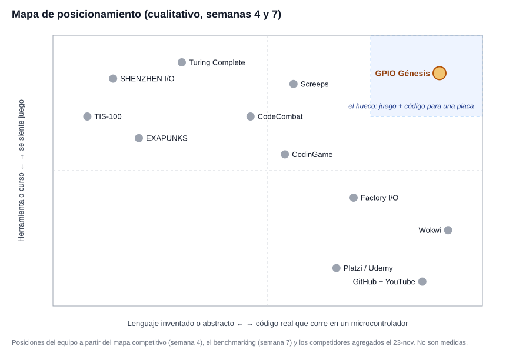

??? note "Competidores directos, indirectos y sustitutos"
    | Tipo | Quién | Precio | Por qué no resuelve lo mismo |
    |---|---|---|---|
    | Directo | SHENZHEN I/O, TIS-100, EXAPUNKS | US$14.99 / ~$119 / ~$340 MXN | Lenguaje ensamblador inventado: no sirve en una placa real |
    | Directo | Turing Complete | US$19.99 | Enseña arquitectura de computadoras, no a programar periféricos |
    | Indirecto | CodeCombat (y CodinGame) | CodeCombat: gratis + US$9.99 al mes | Código real, pero sin microcontroladores ni fábrica |
    | Indirecto | Screeps | Pago | Código real (también C/C++ vía WebAssembly), pero de estrategia, no de embebidos |
    | Indirecto | Factory I/O | Licencia | Fábrica 3D para aprender PLC, no C para microcontroladores |
    | Indirecto | **Wokwi** | Gratis; Hobby €5.6 al mes | Simula la Pico con el Pico SDK, gratis. Es herramienta, no juego: no guía ni explica por qué falla |
    | Indirecto | Platzi, Udemy | ~$4,227 MXN al año / $170–1,530 MXN | Se sienten clase grabada, justo lo que el segmento no quiere |
    | **Sustituto** | **GitHub + YouTube** | $0 | Costo cero y deja un repositorio real. **El más peligroso.** Lo atacamos con el portafolio exportable y el diagnóstico visual |
    | Sustituto | La clase de la universidad | Incluida en la colegiatura | Percibida como aburrida y desconectada |

??? note "Lienzo estratégico (cuatro acciones)"
    - **Eliminar:** el lenguaje inventado (el segmento quiere C/C++ que sirva en el trabajo).
    - **Reducir:** el precio frente a los cursos ($249 contra $1,500–4,200 MXN).
    - **Incrementar:** la conexión con la industria y la retroalimentación visual inmediata (la fábrica muestra qué hace tu código).
    - **Crear:** el portafolio exportable (`main.c` + `CMakeLists` por turno) y la profundidad de sistemas embebidos reales (interrupciones, prioridades del NVIC, registros del RP2350).

    Puntuaciones del lienzo en la [semana 4](semanas/canvas-mercado-semana4.md), sección 4. Advertencia que sigue vigente: en "C/C++ real" empatamos con lo gratuito; la diferencia tiene que venir del diagnóstico y de la experiencia.

## 5. Propuesta de valor y oferta { #s5 }

!!! abstract "v2 · 23-nov-2026 (v1: semana 4, 18-sep)"
    - **Decisión:** propuesta de valor v2, la misma que usa la landing.
    - **Evidencia:** [semana 4](semanas/canvas-mercado-semana4.md), sección 5, y la [landing](gpio-genesis/index.html).
    - **Qué cambió:** la v1 prometía "el único juego…" y "portafolio real"; la v2 promete solo lo que el juego ya hace.
    - **Queda abierto:** probar con usuarios si la frase se entiende sin explicación ([§18](#s18)).

| Propuesta de valor (lo que gana el estudiante) | Oferta técnica (lo que le entregamos) |
|---|---|
| *Aprende C/C++ para microcontroladores arrancando una fábrica de drones: si tu código falla, ves por qué; si funciona, va a tu portafolio.* | Juego para PC con Windows. 9 niveles del bloque 1 del curso (GPIO, máscaras de bits, antirrebote, interrupciones y prioridades del NVIC) + demo avanzada (PWM, ADC, I2C) + demo del copiloto. Se programa en C o C++ con el Pico SDK para una Raspberry Pi Pico 2 virtual. Copiloto con 4 pistas locales por problema y Claude después de la cuarta. Cada turno se exporta como `main.c`/`main.cpp` + `CMakeLists.txt`. $249 MXN pago único; Copiloto Pro opcional, $49 MXN/mes. |

- **Pirámide de Bain:** nivel **funcional** (ahorra tiempo, reduce el esfuerzo de entender un error, informa). Puede subir al **emocional** con la ansiedad de empleabilidad que salió en las entrevistas.
- **Evaluación IDEO:** *Insightful* ✅ (el bloqueo no es falta de ganas, es falta de diagnóstico) · *Unique* ⚠️ (el SDK real y el copiloto que no resuelve nos distinguen, pero Wokwi ya simula la Pico gratis) · *Targeted* ⚠️ (comportamiento verificado; carrera y edad, en su mayoría hipótesis).

!!! warning "El error de la primera versión"
    La v1 (semana 4) decía: «El único juego que convierte tu código C++ en portafolio real de automatización, para estudiantes de ingeniería que aprenden sin que se sienta como tarea». Tenía tres problemas: (1) describía el mecanismo y no lo que gana el usuario (confundir característica con valor); (2) "el único" no se puede comprobar, y la Ley Federal de Protección al Consumidor (art. 32) pide publicidad veraz y comprobable; (3) "portafolio real" prometía más de lo que da el juego (programas cortos e iguales para todos). Además, el juego no es solo C++: las plantillas están en C con el Pico SDK, por eso la v2 dice "C/C++".

## 6. Propiedad intelectual, marca y vigilancia { #s6 }

!!! abstract "v2 · 24-nov-2026 (v1: semana 3, 23-sep)"
    - **Decisión:** marca mixta **GPIO GÉNESIS** en las clases 9 y 41; derechos de autor del juego; el diagnóstico con IA no se patenta.
    - **Evidencia:** [semana 3](semanas/semana-03.md): 6 búsquedas fonéticas en el IMPI y vigilancia en Google Patents.
    - **Qué cambió:** con el repositorio público, las instrucciones del copiloto ya no son un secreto industrial; el secreto se limita a lo que corra en un servidor propio y a los datos de uso.
    - **Queda abierto:** presentar la solicitud de marca y repetir las búsquedas directamente en SIGA y LATIPAT.

| Búsqueda IMPI (23-sep-2026) | Clase 9 | Clase 41 | Lectura |
|---|---|---|---|
| "GPIO" | 0 marcas con GPIO | 0 | Limpio: es lo que hace registrable la marca |
| "Genesis" | SEGA GENESIS y otras, registradas | 6 "GENESIS" registradas | Saturado; nunca registrar "Génesis" solo |
| "GPIO Genesis" | 0 con GPIO | 0 con GPIO | Registrable como compuesto distintivo (**no es opinión legal**) |

| Parte del concepto | Libertad de operación en México | Ajuste |
|---|---|---|
| Juego/simulador con C/C++ real | 🟢 Alta | Ninguno; revisar Robotify Labs antes de vender en EE. UU. o Europa |
| Estación física | 🟢 Alta | Ya no aplica: se descartó en la semana 5 |
| Copiloto IA de diagnóstico | 🟡 Media: CN121583173B (China, 2026) protege comparar ejecución virtual y física | Explicamos en lenguaje natural y comparamos lo **esperado** con lo **simulado**, no con hardware real. Sin patente |

**Estrategia de protección:** marca + derechos de autor del código, el arte y los niveles + velocidad de ejecución. El costo de la solicitud de marca en línea es de unos **$2,814 MXN por clase** (~$5,628 por las clases 9 y 41; **POR VERIFICAR** en impi.gob.mx el día del pago). Licencias: Godot (MIT), fuentes Press Start 2P, JetBrains Mono e Inter (OFL), sin dependencias GPL ([§16](#s16)).

---

## Parte II. Producto

## 7. Especificación del producto (PDS) { #s7 }

!!! abstract "v2 · 24-nov-2026 (v1.0: semana 5, 24-sep · RI-07: semana 6)"
    - **Decisión:** mantenemos los 26 requerimientos y agregamos la columna de estado con su prueba.
    - **Evidencia:** [PDS v1.0](semanas/semana-05.md) y las pruebas del juego (`juego/pruebas/`, 784 pruebas al 23-nov-2026).
    - **Qué cambió:** RI-04 pasó de la API de Arduino-ESP32 a la del Pico SDK; RF-01 se cumple con un intérprete propio en lugar de clang; RI-07 se agregó desde la semana 6; RF-07 (24-nov): la descarga de la demo aparece en la landing solo después del pre-registro, para que la página siga con una sola acción (apartar una copia); el `.exe` está en el Release de GitHub.
    - **Queda abierto:** **6 cumplen, 10 parcialmente, 1 no cumple y 9 están sin probar**: casi todos los pendientes necesitan usuarios o una PC mínima.

**Producto de primera iteración (definición vigente):** un solo `.exe` de 110 MB para Windows que se descarga del Release de GitHub (la landing da el enlace de la demo después del pre-registro), con los 9 niveles del bloque 1 y 2 demos, el compilador incluido, el copiloto (4 pistas locales + Claude con la clave del jugador) y guardado local, sin cuenta. Criterio de éxito (RI-01): 4 de 5 estudiantes del segmento terminan el nivel 1 sin ayuda en 20 minutos o menos.

??? note "Tabla completa de requerimientos con estado"
    | ID | Requerimiento | Verificación | Estado | Prueba / evidencia |
    |---|---|---|---|---|
    | RF-01 | Compilar y ejecutar el C/C++ del jugador en el MCU virtual sin instalar nada | 30 programas (15 válidos, 15 con error) | ✅ | `prueba_lenguaje.gd` (92 pruebas); 41 programas de C dan la misma salida que gcc y 14 de C++ la misma que g++. Se usó la suite, no el set de 30 |
    | RF-02 | Cada escritura o lectura de pin se refleja en la fábrica en el mismo ciclo | Pin a 1 Hz y PWM por 60 s | ✅ | `prueba_perifericos.gd` (143) y trazas en pantalla |
    | RF-03 | Validar el nivel e indicar qué objetivo falló | 1 solución + 3 fallas por nivel | ✅ | `prueba_nivel.gd` (318): soluciones de referencia y errores típicos de los 9 niveles |
    | RF-04 | El copiloto explica en español la causa física, marca la línea y no da la solución completa | Set de 40 errores con rúbrica | ⚠️ | Las 4 pistas locales lo hacen; la respuesta de Claude no se ha evaluado (RD-04) |
    | RF-05 | Sin internet: pista local para ≥ 25 patrones; jugar y guardar | 25/25 sin red | ✅ | 79 tipos de problema distintos con 4 pistas cada uno (155 en los 9 niveles y 2 demos del Pico SDK, en `juego/niveles/`); el guardado es local |
    | RF-06 | Sincronizar con la cuenta y exportar las soluciones | 2 niveles en otra PC; exportado compila | ⚠️ | Exportar: sí (`main.c`/`main.cpp` + `CMakeLists.txt` por turno). Cuenta y sincronización: no hay backend |
    | RF-07 | La landing permite apuntarse y, ya apuntado, descargar la demo | 10 registros de prueba en la hoja en < 5 s; la descarga funciona en Chrome, Edge y Firefox | ⚠️ | Pre-registro hecho, falta conectarlo a Google Forms. El botón «Descargar la demo gratis» sale solo después del pre-registro (un solo CTA) y apunta a `GPIO_Genesis_demo.exe` del Release más reciente: falta crear el Release |
    | RD-01 | Compilar y arrancar: P95 ≤ 3 s (300 líneas, PC mínima) | 50 corridas | ⏳ | No medido |
    | RD-02 | ≥ 30 fps promedio en la PC mínima | Nivel más grande | ⏳ | No medido |
    | RD-03 | Pista local ≤ 200 ms; nube ≤ 8 s | p90 con 5 Mbps | ⚠️ | Local: inmediata (sin red). Nube: sin medir; no hay streaming |
    | RD-04 | ≥ 80% de respuestas correctas y 0 soluciones completas | Set de 40 errores | ⏳ | Pendiente; el filtro de la demo bloquea respuestas con código |
    | RD-05 | ≤ US$0.006 por consulta e IA ≤ 10% del ingreso neto | Logs de tokens del piloto | ⏳ | Estimado: US$0.0005 y 0.5% (cumpliría); tokens sin medir ([§14](#s14)) |
    | RD-06 | 0 cierres con 20 programas defectuosos | Bucle infinito, división entre cero, fuera de arreglo, recursión | ⚠️ | El MCU detiene accesos fuera de arreglo e ISR que se repiten; el set formal de 20 no se ha corrido |
    | RI-01 | 4 de 5 usuarios terminan el tutorial y el nivel 1 sin ayuda | 5 usuarios, ≤ 20 min | ⏳ | [§18](#s18) |
    | RI-02 | Resaltado, números de línea y línea del error marcada | 15 programas con error | ✅ | Capturas de [§12](#s12) y `prueba_nivel.gd` |
    | RI-03 | Todo en español de México, sin traducir las palabras de C | Revisión de cadenas | ⚠️ | Interfaz en español; falta revisar 40 respuestas de Claude |
    | RI-04 v2 | API del Pico SDK para la Pico 2 (RP2350); el nivel 1 también con Arduino | Las plantillas y soluciones compilan | ⚠️ | Las 28 plantillas y soluciones pasan `gcc -Wall -fsyntax-only` con las cabeceras reales del Pico SDK 2.2.0; falta compilar con arm-none-eabi-gcc y probar en una placa |
    | RI-05 | Backend HTTPS/JSON con JWT y respuesta por SSE | curl sin token → 401 | ❌ | No hay backend: el juego llama directo a la API de Anthropic, sin streaming ([§8](#s8)) |
    | RI-06 | Instalar sin compilador, SDK ni cuenta; ≤ 500 MB | VM limpia de Windows 10 | ⚠️ | Un `.exe` de 110 MB sin instalador; falta probarlo en una Windows limpia |
    | RI-07 | En 1366×768 y 1280×720: código ≥ 14 px con ≥ 20 líneas | Greybox en 4 resoluciones | ⏳ | Existe el ajuste de letra (14–36 px); falta la prueba documentada |
    | RR-01 | Primera iteración publicada en itch.io antes de la semana 13 | Build publicado | ⏳ | No publicado |
    | RR-02 | Sin dependencias GPL | Inventario de licencias | ✅ | Godot (MIT), fuentes (OFL), arte y sonidos propios; falta el SBOM formal |
    | RR-03 | Costo del piloto ≤ $600 MXN | Facturación | ⏳ | Sin piloto |
    | RR-04 | Windows 10/11 en la PC mínima | 2 PCs de estudiantes | ⏳ | No probado fuera de nuestras PCs |
    | RR-05 | Aviso de privacidad y nada de nombre o correo al modelo | Revisar 20 peticiones | ⚠️ | La petición a Claude no lleva datos personales (`peticion_ia`); falta el aviso integral ([§16](#s16)) |
    | RR-06 | La clave de la API no va en el cliente; cuota de 10 por hora | Buscar la clave en el `.exe` | ⚠️ | La clave no viene en el `.exe` (la pone cada jugador, cifrada en su PC); no hay cuota |

## 8. Arquitectura del sistema { #s8 }

!!! abstract "v2 · 24-nov-2026 (v1: semana 5, 24-sep)"
    - **Decisión:** híbrido **local primero**: todo corre en la PC del jugador y Claude solo entra cuando las 4 pistas locales no alcanzaron.
    - **Evidencia:** el código en `juego/` y el diagrama de abajo. Versión anterior: [diagrama de la semana 5](recursos/imgs/semana5/arquitectura-gpio-genesis.svg).
    - **Qué cambió:** intérprete propio en lugar de clang → WebAssembly; Pico SDK en lugar de Arduino-ESP32; 4 pistas locales (antes 2 locales y 2 en la nube); sin backend (Supabase, Edge Function y SSE quedaron en el plan); modelo Claude Haiku 5.5 (antes Haiku 4.5).
    - **Queda abierto:** un backend con cuota antes de vender y probar el camino a la nube con una clave real.

[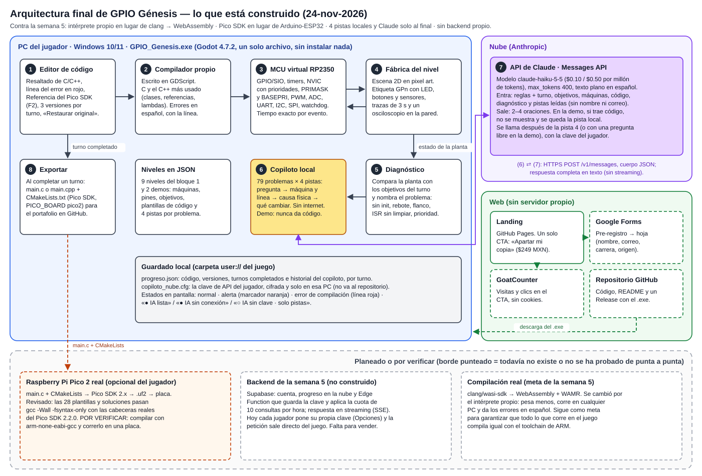](recursos/imgs/proyecto-final/arquitectura-final.svg)

<small>Flujo: (1) el jugador escribe C/C++ → (2) el compilador propio lo convierte en un programa → (3) el MCU virtual lo ejecuta y (4) mueve la fábrica, que le regresa las entradas (botones, sensores) → (5) el diagnóstico compara la planta con los objetivos → (6) el copiloto da la pista que toca → (7) solo después de la cuarta, o con una pregunta libre en la demo, se le pregunta a Claude por HTTPS → (8) al completar un turno se exporta el proyecto.</small>

**¿Por qué local primero? (antes "cloud-first")**

1. **Funciona sin internet y sin clave.** El segmento estudia con la red del campus, que falla. Las pistas escalonadas (79 tipos de problema, 4 pistas cada uno) cubren los errores típicos de cada nivel sin llamar a nadie.
2. **El costo de la IA deja de depender de cuánto pregunta cada jugador.** Con 4 pistas locales, solo los atorados de verdad llegan a la nube: estimamos $0.86 MXN de IA por jugador en todo el MVP ([§14](#s14)).
3. **Respeta la regla de no resolver.** Las pistas locales las escribimos y probamos nosotros; la nube da "otro ángulo" y, en la demo, pasa por un filtro que no deja pasar código.

*Consecuencias:* el `.exe` pesa 110 MB porque lleva el intérprete; cada pista hay que escribirla a mano en el JSON del nivel; y, mientras no haya backend, cada jugador pone su propia clave de API, lo que sirve para la demo pero no para vender.

??? note "Por qué cada protocolo"
    | Conexión | Protocolo y formato | Por qué este | Por qué no otro |
    |---|---|---|---|
    | Juego → Claude | HTTPS POST `/v1/messages`, JSON (`model`, `max_tokens` 400, `system`, `messages`) | Es la interfaz del proveedor; pocas consultas por sesión, iniciadas por el jugador | MQTT o WebSocket no aportan nada a una pregunta y su respuesta |
    | Claude → juego | Respuesta completa en JSON (`content[0].text`) | Es una respuesta de 2–4 oraciones; con un HTTPRequest de Godot alcanza | SSE (streaming) estaba en la semana 5 para que el texto saliera más rápido; queda para cuando haya backend |
    | Juego → disco | `progreso.json` y `copiloto_nube.cfg` (cifrado) en `user://` | Sin cuenta ni servidor; la clave no sale de la PC | Supabase (semana 5) solo hace falta para jugar en varias PCs |
    | Exportar | Archivos `main.c`/`main.cpp` + `CMakeLists.txt` | Es lo que un estudiante sube a GitHub y compila con el Pico SDK | Subir directo a GitHub con OAuth (semana 5) no era necesario para la demo |
    | Landing → Google Forms | HTTPS POST a `formResponse` (sin servidor propio) | Gratis y la hoja de cálculo ya es la lista de pre-registros | Supabase para una lista de espera era de más |
    | Landing → GoatCounter | Petición de conteo, sin cookies | Mide visitas y clics sin aviso de cookies | Google Analytics pide aviso de cookies |

## 9. Diseño del producto { #s9 }

!!! abstract "v2 · 24-nov-2026 (v1: semana 6, 1-oct)"
    - **Decisión:** concepto "Primer turno": arte de C3 + funciones de C1 + mini-trazas de C2.
    - **Evidencia:** [semana 6](semanas/semana-06.md) (tabla morfológica, 3 conceptos, [matriz de Pugh](recursos/archivos/semana6/pugh-gpio-genesis.xlsx), boceto técnico v2).
    - **Qué cambió del boceto al juego:** etiquetas `D5` → `GP5` (Pico SDK); un solo botón de ayuda en lugar de "Pedir ayuda" + "Otra pista"; osciloscopio en la pared en los niveles 6–9; pestañas por turno, versiones y Referencia (F2).
    - **Queda abierto:** el tope de 30 h de arte nunca se midió: el arte sigue siendo provisional (generado por script).

**Principios de diseño aplicados (los 7 del curso):** *affordances* (cada máquina lleva la etiqueta de su pin con el mismo nombre que la constante del código, `GP5 · MOTOR_BANDA`) · *contour bias* (paneles redondeados y luces cálidas; triángulos y octágonos solo para alertas) · *consistencia* (un color por tipo de señal en el código, el LED y la traza) · *constraints* (la plantilla ya trae las constantes; no se ejecuta si no compila) · *confirmación* (LED y traza → palomita del objetivo → banner y copiloto) · *costo-beneficio* (el pixel art cuesta ~28 h más y lo elegimos porque "se siente juego" pesa 15%) · *ciclo de desarrollo* (boceto → crítica con IA → v2 → juego).

**Matriz de Pugh** (deseabilidad 55%; regla: ≥ 40%): ronda 1 contra el datum C1 → C3 −40, C2 −60. Ganó el concepto convencional porque era el más claro. Ronda 2: la combinación final queda **+5** contra C1, con los mismos pesos.

=== "Render del concepto elegido (semana 6)"

    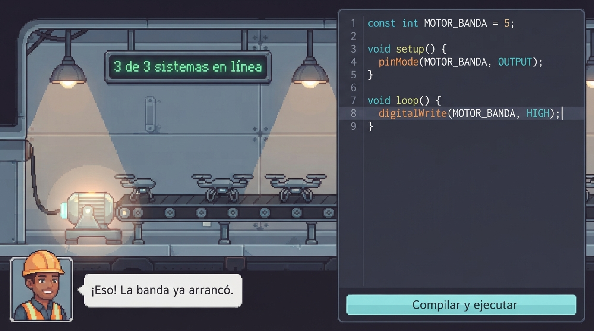

=== "Boceto técnico v2 (1-oct)"

    [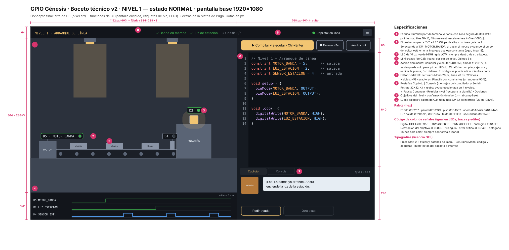](recursos/imgs/semana6/boceto-nivel1-normal.svg)

=== "Juego, 8-nov"

    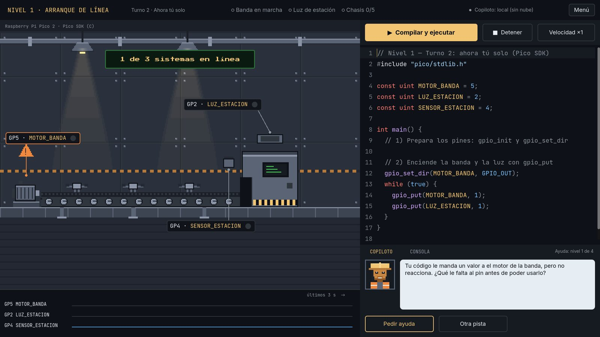

=== "Juego, 23-nov"

    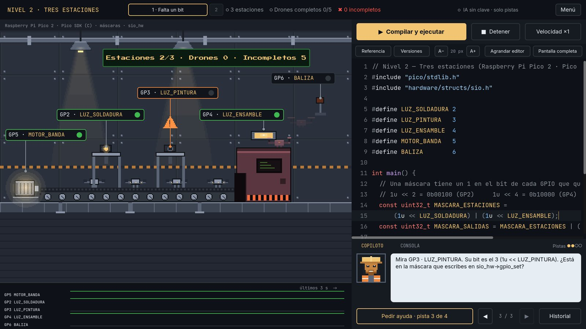

## 10. Prototipos y evidencia { #s10 }

!!! abstract "v1 · 24-nov-2026"
    - **Decisión:** cada prototipo respondió una pregunta técnica o de experiencia; el siguiente ciclo tiene que ser con usuarios.
    - **Evidencia:** semanas 6–7, `juego/` y `Claude outputs/` (capturas fechadas).
    - **Qué cambió:** primera versión de esta sección.
    - **Queda abierto:** **ningún prototipo tiene todavía evidencia de usuarios** (el curso pide mínimo 3). Es lo primero de [§18](#s18).

| # | Fecha | Pregunta | Tipo · resolución | Qué se construyó | Evidencia | Aprendizaje → cambio de diseño |
|---|---|---|---|---|---|---|
| P1 | 1-oct | ¿Qué estilo deja ver qué pin mueve qué máquina y "se siente juego"? | Forma/experiencia · baja | 6 renders con IA (menú y nivel 1 de 3 conceptos) | Evaluación de nosotros dos ([semana 6](semanas/semana-06.md)) | C1 era el más claro y C3 el que más gustaba → concepto combinado |
| P2 | 1-oct | ¿El boceto aguanta 6–8 máquinas y 4 resoluciones? | Función · baja | Boceto técnico v1 + crítica con IA | 3 problemas críticos | Etiquetas compactas, zona segura 384×240, disparador del copiloto a los 10 s |
| P3 | 5-nov | ¿Podemos ejecutar el código del jugador dentro del juego? | Función · alta | Nivel 1 jugable con intérprete propio (API de Arduino) | 44 pruebas del intérprete + 23 de humo | Intérprete en GDScript en lugar de clang → WebAssembly |
| P4 | 8-nov | ¿Se puede enseñar con la API del curso? | Función · alta | Nivel 1 con el Pico SDK para la Pico 2 | Pruebas de Pico SDK; captura del 8-nov | El Pico SDK pasa a ser la opción por defecto (RI-04 v2) |
| P5 | 21–22 nov | ¿El simulador reproduce tiempos como el chip (rebote, latencia, prioridades)? | Función · alta | Niveles 2–9, registros del RP2350 y NVIC | 41 programas = gcc; 28 plantillas con las cabeceras reales del SDK | MCU con tiempo exacto por evento y osciloscopio en la pared |
| P6 | 22–23 nov | ¿El copiloto puede guiar sin escribir el código? | Experiencia · alta | Demo del copiloto (cabina de pintura) | Prueba que revisa que ninguno de los ~100 textos lleve código; resumen «líneas que escribió el copiloto: 0» | 4 pistas locales y Claude al final; una sola fila para preguntar |
| P7 | 23–24 nov | ¿Alguien aparta una copia de $249? | Negocio · alta | Landing con pre-registro | **PENDIENTE**: publicarla y medir ([§19](#s19)) | — |

??? note "Ciclo de aprendizaje en imágenes"

    === "P1 · renders (1-oct)"

        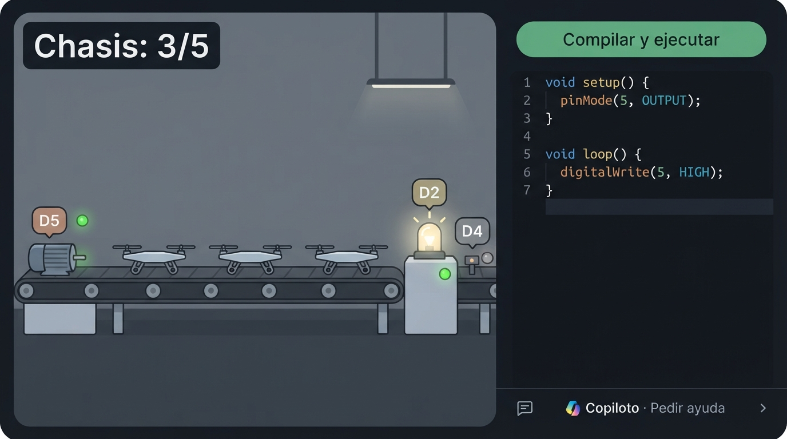{ width="49%" } { width="49%" }

    === "P4 · Pico SDK (8-nov)"

        

    === "P5 · interrupciones (22-nov)"

        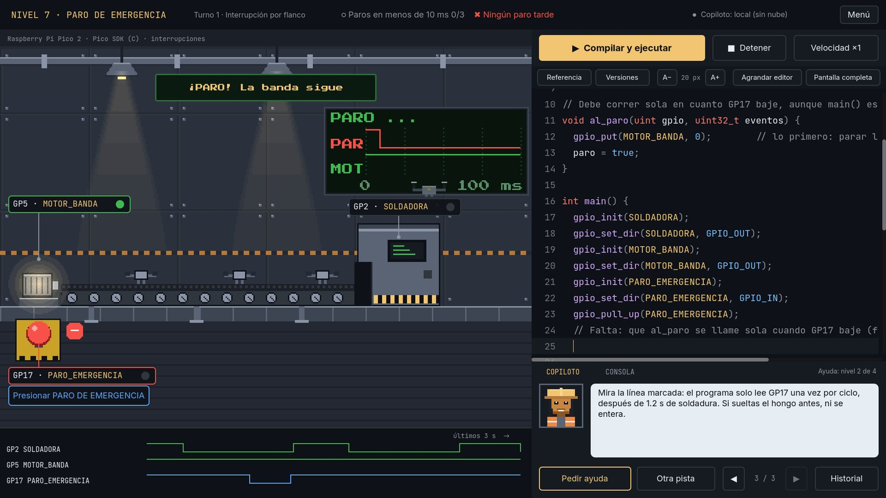

    === "P6 · copiloto (23-nov)"

        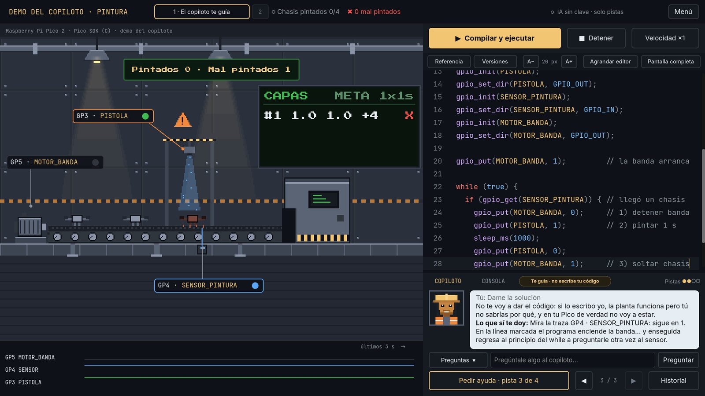

## 11. Manufactura, DFM y circularidad { #s11 }

!!! abstract "v1 · 24-nov-2026"
    - **Decisión:** en un producto digital, "manufacturar" una copia es exportar el `.exe` y distribuirlo; el costo por copia es la comisión de la tienda más la IA.
    - **Evidencia:** [Excel de costos](recursos/archivos/semana7/costos-gpio-genesis-semana7.xlsx) (hoja Costos DFS) y `juego/export_presets.cfg`.
    - **Qué cambió:** la revisión DFM bajó el costo variable de $100.95 a $75.56 MXN por copia (−25%).
    - **Queda abierto:** cotizar la firma de código y el dominio; probar la exportación en una Windows limpia.

??? note "BOM final (servicios y licencias)"
    | Componente | Especificación | Precio unitario | Proveedor | Tiempo de entrega |
    |---|---|---|---|---|
    | IA del copiloto | Claude Haiku 5.5, US$0.10 / US$0.50 por millón de tokens | $0.86 MXN por jugador en el MVP (**ESTIMADO**) | [Anthropic](https://platform.claude.com/docs/en/about-claude/pricing) | Inmediato (cuenta y tarjeta) |
    | Motor | Godot 4.7.2 (MIT) | $0 | [Godot](https://godotengine.org/download) | Inmediato |
    | Fuentes | Press Start 2P, JetBrains Mono, Inter (OFL) | $0 | Google Fonts / JetBrains | Inmediato |
    | Tienda | Steam Direct | US$100 por juego, una vez + 30% de cada venta | [Steamworks](https://partner.steamgames.com/doc/gettingstarted/appfee) | Revisión de Valve: **POR VERIFICAR** |
    | Firma de código | Certificado OV | ~US$99 al año (**ESTIMADO**) | Autoridad certificadora | Días a semanas por la validación: **POR VERIFICAR** |
    | Backend (al vender) | Supabase Pro | US$25 al mes | [Supabase](https://supabase.com/pricing) | Inmediato |
    | Dominio | gpiogenesis.com | ~US$12 al año (**ESTIMADO**) | Registrador | Inmediato |
    | Página, pre-registro y métricas | GitHub Pages, Google Forms, GoatCounter | $0 | GitHub, Google, GoatCounter | Inmediato |

**Volumen y proceso:** piloto de 20 jugadores (descarga gratis desde un Release de GitHub) y lanzamiento de 400 copias en el año 1 (escenario base) en Steam. El proceso es el mismo para 1 o 1,000 copias: exportar con Godot (preset "Windows Desktop", el paquete va dentro del `.exe`), subir y distribuir. Una versión nueva toma minutos.

| Revisión DFM | Antes (semana 5) | Después (24-nov) |
|---|---|---|
| IA por jugador | $26.25 MXN (300 consultas, todo en la nube con Haiku 4.5) | $0.86 MXN (220 consultas, la mitad o menos a la nube, Haiku 5.5) |
| Comisión de la tienda | $74.70 | $74.70 |
| **Costo variable por copia** | **$100.95** | **$75.56 (−25%)** |
| "Ensamble" (instalación) | Instalador con compilador clang + cuenta | Un solo `.exe`, sin cuenta ni instalador |
| Mayor riesgo técnico | Cadena C++ → WebAssembly (60 h estimadas) | Intérprete propio, ya probado |

??? note "Las cuatro preguntas de circularidad, traducidas a software"
    | Pregunta del curso | Versión digital | Respuesta y cambio |
    |---|---|---|
    | ¿Se puede reparar? | ¿Se arregla una parte sin romper otra? | Cada nivel es un JSON y su fábrica un script aparte; los errores se corrigen con un parche del `.exe` |
    | ¿Módulos reemplazables? | ¿Se cambia una pieza sin rehacer el resto? | El proveedor de IA cambia con una variable (`GPIO_MODELO`); el intérprete y la fábrica están separados |
    | ¿Materiales identificables? | ¿Se sabe de dónde viene cada pieza y su licencia? | Fuentes con su licencia OFL incluida; arte y sonido propios. **PENDIENTE:** inventario de licencias (SBOM) |
    | ¿Se actualiza sin reemplazar? | ¿Crece sin comprar otro juego? | Los bloques 2 y 3 van como actualización; las partidas viejas se siguen leyendo. Además, corre en una PC de 8 GB con gráficos integrados: no obliga a cambiar de computadora |

??? note "Cómo reproducir una unidad"
    1. Clonar el [repositorio](https://github.com/JC3468/Proyecto_ing_4) e instalar [Godot 4.7.2](https://godotengine.org/download) (versión estándar, no .NET).
    2. Abrir `juego/project.godot`; en Godot: **Editor → Administrar plantillas de exportación → Descargar e instalar**.
    3. Correr las pruebas: `godot --headless --path juego --script res://pruebas/prueba_nivel.gd` (y `prueba_mcu`, `prueba_lenguaje`, `prueba_perifericos`, `prueba_referencia`). Deben terminar en "TODAS LAS PRUEBAS PASARON".
    4. Exportar: **Proyecto → Exportar… → Windows Desktop**, o `godot --headless --path juego --export-release "Windows Desktop" GPIO_Genesis.exe`.
    5. Abrir el `.exe` en una PC sin Godot.

## 12. Aplicación conectada { #s12 }

!!! abstract "v2 · 24-nov-2026 (v1: wireframes, semana 6)"
    - **Decisión:** la "aplicación" es el juego: fábrica + editor + copiloto en una sola pantalla.
    - **Evidencia:** `juego/` (Godot 4.7.2), [README del juego](https://github.com/JC3468/Proyecto_ing_4/blob/main/juego/README.md) y las capturas de abajo.
    - **Qué cambió:** el modelo por defecto pasó a `claude-haiku-5-5` (24-nov), el que se usó para costear la semana 7. El `.exe` del 23-nov todavía usa Haiku 4.5: hay que volver a exportarlo.
    - **Queda abierto:** subir el código con commits por sesión y publicar el `.exe` en un Release.

**Flujo del usuario:** abrir el `.exe` → la primera vez entra directo al nivel 1 con el código al 90% ("2 de 3 sistemas en línea") → escribe una línea → **Compilar y ejecutar** (Ctrl+Enter) → la banda arranca → ventana «Turno 1 completado» → **Exportar turno 1** o **Ir al turno 2** → al terminar los turnos, **Siguiente nivel**. Wireframes del menú, la alerta y la primera vez en la [semana 6](semanas/semana-06.md), sección 8.

=== "Normal y pistas"

    

    Las 4 pistas son locales («Pistas ●●○○»). Arriba a la derecha: «○ IA sin clave · solo pistas».

=== "Alerta"

    

    El objetivo fallido en rojo, el paro marcado en la planta y el osciloscopio con la latencia. (Captura del 22-nov, antes del panel nuevo del copiloto.)

=== "No da el código (demo)"

    

=== "Respuesta de Claude"

    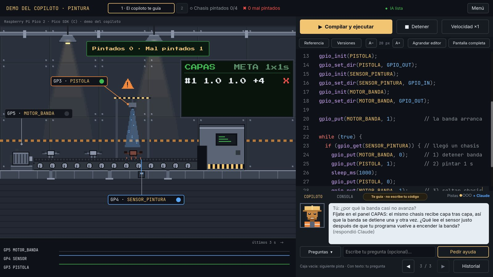

    **Captura de una prueba automática con respuesta simulada.** Falta probar con la API real.

=== "Turno completado"

    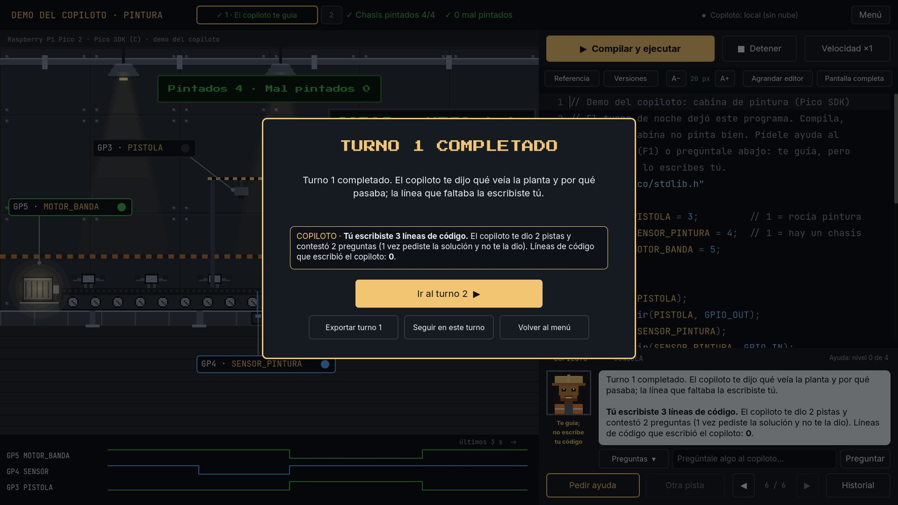

=== "Menú de niveles"

    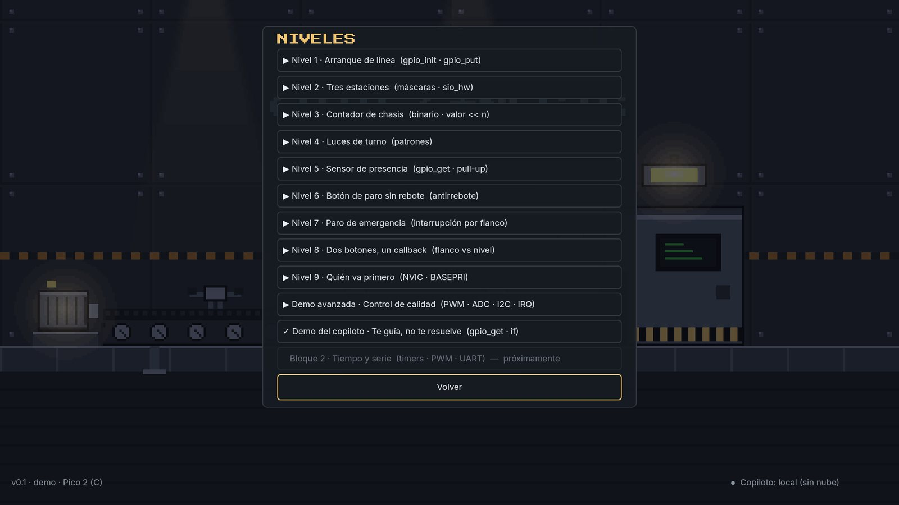

| Estado | Cómo se ve |
|---|---|
| Cargando | Pantalla de inicio de Godot y, la primera vez, el nivel 1 abre solo |
| Normal | Objetivos con ○/✓ arriba, LED y trazas por pin, «● IA lista» si hay clave |
| Alerta | Marcador naranja en la máquina, objetivo en rojo, el copiloto empieza con una pregunta |
| Sin conexión | «● IA sin conexión»: el botón sigue dando las pistas locales y avisa que no pudo hablar con la IA |
| Error | Línea en rojo y mensaje en español en la Consola («Falta ';' al final de la línea 12»); el MCU se detiene con la causa |

??? note "Conexión con la nube: protocolo y formato"
    Petición (resumida) que arma `peticion_ia()` en `juego/scripts/copiloto/copiloto.gd`:
    ```json
    {
      "model": "claude-haiku-5-5",
      "max_tokens": 400,
      "system": "Eres el copiloto de GPIO Génesis... explica por qué su código no produce lo que espera la planta... no le escribas la solución completa... texto plano, sin Markdown.",
      "messages": [{"role": "user", "content": "Turno: ...\nObjetivos: ...\nMáquinas del nivel: ...\nCódigo del estudiante: ...\nDiagnóstico del juego: {...}\nPistas que ya leyó: ..."}]
    }
    ```
    Va por HTTPS a `https://api.anthropic.com/v1/messages` con las cabeceras `x-api-key` (la clave del jugador) y `anthropic-version: 2023-06-01`. No lleva nombre, correo ni ningún dato del jugador.

**Cómo correrlo:** descargar `GPIO_Genesis.exe` del [Release](https://github.com/JC3468/Proyecto_ing_4/releases) (**PENDIENTE**) y abrirlo con doble clic; o abrir `juego/project.godot` en Godot 4.7.2 y presionar F5. Para la IA: **Menú → Opciones → Copiloto en la nube**, pegar una clave de Anthropic, **Guardar** y **Probar conexión**.

??? note "Limitaciones conocidas"
    - El código lo ejecuta un intérprete: no es el compilador de ARM. Falta comprobar en una placa que los `main.c` exportados compilan y corren igual.
    - C++ sin `template`, `new`/`delete`, `std` (`cout`, `vector`), herencia ni excepciones; el error dice qué usar en su lugar.
    - Sin UART, SPI ni watchdog en niveles todavía (el simulador ya los tiene); bloques 2 y 3 sin niveles.
    - Solo Windows; sin cuenta ni guardado en la nube; cada jugador necesita su propia clave para la IA.
    - Arte y sonidos provisionales, generados por script.
    - El `.exe` no está firmado: Windows SmartScreen mostrará una advertencia al abrirlo.

---

## Parte III. Negocio

## 13. Business Blueprint { #s13 }

!!! abstract "v1 · 24-nov-2026 (modelo de ingresos: semana 7, 22-oct)"
    - **Decisión:** dos capas: juego de pago único + Copiloto Pro opcional.
    - **Evidencia:** [semana 7](semanas/semana-07.md), secciones 2 y 3, y [modelo financiero](recursos/archivos/semana7/modelo-financiero-gpio-genesis-semana7.xlsx) (hoja Benchmark).
    - **Qué cambió:** primera versión del lienzo de 8 cajas.
    - **Queda abierto:** Pro contradice lo que dijeron 3 de 4 entrevistados ("comprar un juego"); hay que validarlo en el piloto.

| Caja | Contenido | Sección |
|---|---|---|
| **Clientes** | Estudiantes de ingeniería (18–25) que juegan simuladores y cursan materias de microcontroladores; después, profesores y universidades | [§3](#s3) |
| **Propuesta de valor** | Aprende C/C++ para microcontroladores arrancando una fábrica de drones: si falla, ves por qué; si funciona, va a tu portafolio | [§5](#s5) |
| **Oferta** | Juego para PC (bloque 1: 9 niveles + 2 demos) con copiloto y exportación al portafolio | [§5](#s5), [§12](#s12) |
| **Modelo de ingresos y precio** | $249 MXN pago único (Steam) + Copiloto Pro $49 MXN/mes (Stripe), opcional | [§14](#s14) |
| **Canales** | Demos en salones con QR → landing; GitHub, YouTube y TikTok orgánicos; Release/itch.io para el piloto y Steam para el lanzamiento | [§15](#s15), [§19](#s19) |
| **Costos** | Horas del equipo ($50,597 MXN el MVP, contando horas), comisión de Steam (30%), IA ($0.86 por jugador), lanzamiento y nube del año 1 ($8,943 MXN: cuota de Steam, firma, dominio y Supabase Pro) | [§14](#s14) |
| **Socios** | Anthropic (IA), Godot (motor), Raspberry Pi (Pico SDK, solo como referencia de la API), Valve (Steam); posibles: profesores de Sistemas Embebidos | [§11](#s11), [§16](#s16) |
| **Equipo y recursos** | 2 estudiantes de mecatrónica que llevan Sistemas Embebidos; Claude Code para programar; 784 pruebas automáticas | [§1](#s1), [§21](#s21) |

??? note "Benchmarking de 3 ofertas parecidas (precios del 22-oct-2026)"
    | Oferta | Qué vende | Quién paga y cuándo | Precio | Fricción |
    |---|---|---|---|---|
    | SHENZHEN I/O | Juego de puzles con microcontroladores inventados | El jugador, una vez | US$14.99 (~$262 MXN) | Lenguaje ficticio, en inglés |
    | Turing Complete | Juego de construir una computadora | El jugador, una vez | US$19.99 (~$350 MXN) | Arquitectura, no periféricos; en inglés |
    | Wokwi Hobby | Simulador web de Arduino, ESP32 y Pico | El usuario, cada mes (el plan gratis ya simula) | €5.6 al mes (~$115 MXN) | Herramienta, no juego: no guía ni motiva |

    **Qué predomina:** los juegos cobran una vez ($120–350 MXN); las herramientas, suscripción ($115–175 MXN/mes). **Lo que nadie cobra:** la ayuda personalizada mientras aprendes, que es lo que intenta cobrar Copiloto Pro.

**Reto de diseño del modelo:** el juego tiene final. Cuando el jugador termina los niveles (o el semestre) deja de tener razón para pagar Pro; por eso supusimos 35% de bajas al mes y por eso el juego funciona completo sin Pro.

## 14. Costos, precio y viabilidad financiera { #s14 }

!!! abstract "v2 · 24-nov-2026 (v1: semana 7, 9 y 22-oct)"
    - **Decisión:** precio de $249 MXN y alcance de lanzamiento = MVP (los bloques 2 y 3 como actualizaciones).
    - **Evidencia:** [modelo financiero](recursos/archivos/semana7/modelo-financiero-gpio-genesis-semana7.xlsx), [costos](recursos/archivos/semana7/costos-gpio-genesis-semana7.xlsx) y [alcance y niveles](recursos/archivos/semana7/alcance-niveles-costos-gpio-genesis.xlsx), con fórmulas visibles.
    - **Qué cambió (24-nov):** los tres Excel quedaron conciliados: 423 h del MVP en 5 ciclos (84.6 h por ciclo), 220 consultas por jugador y plan gratuito de Supabase en el escenario pesimista ([semana 7](semanas/semana-07.md), nota del 24-nov).
    - **Queda abierto:** **los tokens no están medidos**; cotizar firma y dominio; consultar impuestos con un contador.

??? note "Costos CREAR y DISTRIBUIR clasificados D / F / S"
    | Partida | Tipo | MVP | 3 bloques | Por copia |
    |---|---|---|---|---|
    | Motor del juego | D | $20,571 | $20,571 | — |
    | Simulación de periféricos | D | $2,392 | $21,528 | — |
    | Niveles del bloque 1 | D | $5,741 | $14,352 | — |
    | Copiloto IA (desarrollo) | D | $3,588 | $3,588 | — |
    | Niveles de los bloques 2 y 3 | F | $0 | $28,704 | — |
    | Arte base y de máquinas | F | $9,927 | $17,103 | — |
    | Sonido | F | $2,392 | $4,425 | — |
    | Supabase Pro (12 meses) | F | $5,250 | $5,250 | — |
    | Firma de código, dominio | F | $1,943 | $1,943 | — |
    | IA del copiloto por jugador | D | — | — | $0.86 (MVP) / $6.28 |
    | Comisión de Steam | S | — | — | $74.70 |
    | Cuota de Steam | S | $1,750 | $1,750 | — |

    Montos de desarrollo con 15% de indirectos y 30% de contingencia. Regla del curso: si no cierra, se recortan primero los F; los que no cierran son los niveles de los bloques 2 y 3, que son F.

**Costo de la IA (estimado, no medido):** 3,000 tokens de entrada + 400 de salida por consulta con Haiku 5.5 = US$0.0005 por consulta → **$1.31 MXN al mes por usuario activo** (5 consultas al día × 30 días) y **$0.86 MXN por jugador en todo el MVP**. La petición real del juego ([§12](#s12)) lleva las reglas, el código y el diagnóstico del nivel: no sabemos si pesa más o menos que 3,000 tokens hasta medirla. **Cómo lo vamos a medir:** con la clave del equipo, hacer 10 consultas en la demo del copiloto y leer los tokens de entrada y salida en el panel de uso de la consola de Anthropic (o con el endpoint `count_tokens`); poner el promedio en `Supuestos!B11:B12` del Excel de costos.

| Indicador | MVP (5 niveles) | 3 bloques (22 niveles) | Fuente |
|---|---|---|---|
| Desarrollo por ciclos de aprendizaje (3 / 5 / 8 ciclos) | $30,358 / **$50,597** / $80,954 | — | Costos, hoja Desarrollo |
| Costo unitario a 10 copias / 100 copias | $6,030 / $671 | $12,606 / $1,334 | Modelo, Costo unitario |
| Precio: piso cost-plus (40%, 400 copias) → techo value-based | **$299 → $350** | $639 → $350 | Modelo, Precio |
| Precio recomendado | **$249** (debajo del piso: cubre costos, no el 40% de margen) | $249 (no cubre costos) | [semana 7](semanas/semana-07.md) §4.2 |
| Equilibrio contando horas / solo efectivo | **322 / 49 copias** | 697 / 50 copias | Modelo, Equilibrio |
| Mes en que el acumulado se vuelve positivo (base) | 9 | no en 12 meses | Modelo, Flujo 12 meses |

**¿Por qué $249 si el piso es $299?** Entra en lo que dijo el segmento ($100–400 MXN), queda entre SHENZHEN I/O ($262) y Turing Complete ($350), y en efectivo se recupera con 49 copias. Lo que no recuperaríamos con menos de 322 copias son nuestras horas.

**VPN a 12 meses** con una tasa de **15% anual** (1.17% mensual), la que propone el curso como costo de oportunidad razonable para un emprendedor en México:

| Escenario de ventas (año 1) | VPN MVP | VPN 3 bloques | VPN MVP, solo efectivo |
|---|---|---|---|
| Pesimista (150 copias, Supabase gratis) | −$28,418 | −$94,866 | +$22,173 |
| **Base (400 copias)** | **+$9,829** (TIR 4.6% mensual) | −$57,892 | +$60,420 |
| Optimista (1,100 copias = SOM) | +$130,561 | +$59,275 | +$181,152 |

**Lectura:** el MVP es **marginalmente viable** (positivo en el escenario base, por poco); los 3 bloques, **inviables** en 12 meses salvo que vendamos todo el SOM. En efectivo nunca perdemos: lo que arriesgamos es tiempo.

## 15. Go-to-market y economía unitaria { #s15 }

!!! abstract "v1 · 24-nov-2026"
    - **Decisión:** lanzamiento orgánico empezando por salones de Sistemas Embebidos, con pre-registro gratis y un piloto de 20 jugadores.
    - **Evidencia:** [economía unitaria (Excel con fórmulas)](recursos/archivos/proyecto-final/economia-unitaria-gpio-genesis.xlsx).
    - **Qué cambió:** primera versión; el Excel nuevo trae un registro de difusión para medir el CAC real.
    - **Queda abierto:** **todo lo de esta sección es SUPUESTO hasta tener visitas y pre-registros**.

**Cliente número uno:** estudiante de Mecatrónica o Electrónica de 19–23 años que cursa Sistemas Embebidos con la Raspberry Pi Pico 2, juega Minecraft o simuladores en una laptop con Windows y ha comprado juegos independientes de $100–400 MXN. (Carrera y edad: HIPÓTESIS; juego y precio: VERIFICADO en 4 entrevistas.)

| Canal | Cuándo conviene | Qué aprendemos | Riesgo |
|---|---|---|---|
| Demo de 10 min en un salón + QR a la landing | Ahora: el segmento está concentrado y el profesor da credibilidad | Conversión visita → pre-registro por grupo (`?ref=salon`) | Depende de que un profesor nos preste la clase |
| GitHub, YouTube y TikTok orgánicos | Desde el pre-registro; cuesta horas, no dinero | Qué mensaje atrae (problema contra demo) | Lento; compite con contenido gratis |
| Release de GitHub / itch.io (piloto) | Piloto de 20 jugadores, gratis a cambio de 30 min de prueba | Si terminan el nivel 1 solos y si pagarían | Sin firma de código, SmartScreen asusta |
| Steam | Lanzamiento, con la demo gratis del nivel 1 | Ventas reales y reseñas | 30% de comisión; revisión y divulgación de IA |
| Licencia escolar (venta directa) | Cuando un profesor lo quiera usar con su grupo | Si las universidades pagan (hipótesis de la semana 2) | Ciclos de venta lentos; facturación |

**Plan de preventa y piloto:** (1) publicar la landing y medir visitas, clics y pre-registros; (2) a quienes se registren, invitarlos al piloto de 20 jugadores con el `.exe` del Release; (3) al final del piloto, preguntar con compromiso (dejar tarjeta para la compra anticipada o pagar Pro un mes), no con opiniones.

| Métrica | Valor | ¿Medido o supuesto? |
|---|---|---|
| Contribución del juego por copia | $173.44 | SUPUESTO (IA estimada) |
| Churn mensual de Pro | 35% → vida media 2.9 meses | SUPUESTO |
| LTV por comprador (juego + 10% que toma Pro) | $185.11 | SUPUESTO |
| CAC | $44.40 (16 h al mes de difusión × $80 + $200 de traslados ÷ 33 copias al mes) | SUPUESTO |
| LTV ÷ inversión | **4.2×** (regla práctica: ≥ 3) | SUPUESTO |
| Payback | **0 meses**: el pago único cubre el CAC el día de la compra | SUPUESTO |
| CAC máximo para LTV ÷ inversión = 3 | $61.70 | Derivado |

**Sensibilidad (±25% por insumo) y palancas:** el CAC y el precio son los que más mueven el resultado (de −24% a +33%); churn y conversión a Pro casi no pesan (±2%) porque Pro es ~6% del LTV. Palancas: subir el precio a $299 → 4.96×; referidos y demos en clase (CAC a la mitad) → 8.3×; licencia escolar de 30 alumnos a $150 → 9.3× por grupo; si la API sube 10 veces → 3.84×. **Alerta:** con el mismo esfuerzo de difusión pero solo 150 copias al año (pesimista), el CAC sube a $118 y la razón cae a **1.6×**: ahí no cumple la regla.

## 16. Regulación y legal { #s16 }

!!! abstract "v1 · 24-nov-2026"
    - **Decisión:** antes de vender a alguien de fuera hay que resolver datos personales, términos de venta, la divulgación de IA en Steam, la marca y el alta fiscal.
    - **Evidencia:** fuentes oficiales enlazadas en la tabla; **no es asesoría legal**.
    - **Qué cambió:** primera versión del checklist.
    - **Queda abierto:** revisar el borrador de aviso de privacidad con alguien que sepa de derecho.

| Tema | ¿Aplica? | Qué exige | Documento o trámite | Quién lo emite | Costo y tiempo | Estatus |
|---|---|---|---|---|---|---|
| Radio y homologación | No | — | — | IFT | — | VERIFICADO: no hay hardware |
| Datos personales | Sí: la landing pide nombre, correo y carrera | Aviso de privacidad desde que se recaban los datos y respetar los derechos del titular | [LFPDPPP](https://www.diputados.gob.mx/LeyesBiblio/ref/lfpdppp.htm) (DOF 20-03-2025, en vigor el 21-03-2025) | Secretaría Anticorrupción y Buen Gobierno (antes INAI) | $0; redactarlo | POR VERIFICAR: el aviso actual es simplificado y le falta el correo de contacto |
| Seguridad y etiquetado | Probablemente: clasificación de contenido | Mostrar la clasificación del videojuego | [Lineamientos Generales del Sistema Mexicano de Equivalencias de Clasificación de Contenidos de Videojuegos](https://dof.gob.mx/nota_detalle_popup.php?codigo=5606047) (DOF 27-11-2020, en vigor desde el 27-05-2021) | SEGOB | Probablemente "A, todo público" | POR VERIFICAR si aplica a una tienda digital |
| Baterías | No | — | — | — | — | VERIFICADO |
| Licencias de software e IA | Sí | Avisos de licencia (Godot MIT, fuentes OFL); términos comerciales y política de uso de Anthropic | Leer los términos vigentes; SBOM | Cada proyecto / Anthropic | $0 | POR VERIFICAR |
| Venta en Steam con IA | Sí | Declarar en el cuestionario de contenido el contenido generado por IA en vivo y describir los límites que le ponemos | Content Survey de Steamworks | Valve | $0 | POR VERIFICAR: nuestros límites son el filtro de código y las instrucciones del copiloto |
| Términos de venta | Sí | Publicidad veraz y comprobable; reembolsos de la tienda; cancelación de Pro | [LFPC, art. 32](https://www.diputados.gob.mx/LeyesBiblio/pdf/LFPC.pdf); términos de Steam y Stripe | PROFECO | $0 | En curso: la landing ya no promete lo que el juego no hace |
| Economía circular | No aplica a un producto digital | — | — | — | — | VERIFICADO; buena práctica en [§11](#s11) |
| Exportación e impuestos | Sí: Steam vende fuera de México | Alta en el SAT e IVA/ISR de los ingresos | Consulta con un contador | SAT | Por cotizar | POR VERIFICAR |
| Marca | Sí | Solicitud de marca mixta, clases 9 y 41 | Marca en Línea | IMPI | ~$2,814 MXN por clase; meses | POR VERIFICAR |

??? note "Borrador de aviso de privacidad integral y términos básicos (revisar antes de usarlo)"
    **Aviso de privacidad.** José Carlos y Yael, equipo de GPIO Génesis (proyecto escolar), son responsables de los datos que dejas en el pre-registro: nombre, correo, carrera y la página de la que llegaste. Los usamos para avisarte del lanzamiento, invitarte al piloto y medir cuánto interés hay. No los vendemos ni los compartimos; se guardan en una hoja de Google Forms a la que solo tenemos acceso nosotros. Puedes pedir que los corrijamos o los borremos escribiendo a **[correo de contacto, PENDIENTE]**; respondemos en un máximo de 20 días hábiles. Si cambiamos este aviso, lo publicaremos en esta misma página. *Domicilio para notificaciones: PENDIENTE.*

    **El juego** no pide cuenta ni datos personales. Tu progreso y tu código se guardan en tu computadora. Si pones tu clave de Anthropic y pides ayuda a la IA, el juego envía a Anthropic tu código, el estado del nivel y tu pregunta (nunca tu nombre ni tu correo). La clave se guarda cifrada solo en tu PC.

    **Términos básicos.** El juego es una versión de prueba y puede tener errores. El copiloto puede equivocarse: verifica lo que te diga. El código que escribes y exportas es tuyo. Raspberry Pi, Pico y Arduino son marcas de sus dueños; GPIO Génesis no tiene relación con esas empresas.

**Qué falta antes de venderle a alguien de fuera:** (1) aviso de privacidad integral con correo y domicilio; (2) un backend con nuestra clave, límite de gasto y cuota (no pedirle su clave al jugador); (3) la declaración de IA en Steam; (4) términos de venta y de cancelación de Pro; (5) la solicitud de marca; (6) el alta en el SAT.

---

## Parte IV. Validación y lanzamiento

## 17. Integración y pruebas del sistema { #s17 }

!!! abstract "v1 · 24-nov-2026"
    - **Decisión:** adaptamos las cuatro fronteras y las pruebas T1–T6 del curso a un juego sin hardware.
    - **Evidencia:** suites de `juego/pruebas/` (784 pruebas al 23-nov-2026: 48 + 92 + 143 + 318 + 183) y el registro de errores en `juego/CLAUDE.md`.
    - **Qué cambió:** primera versión; durante esta revisión encontramos que el juego usaba Haiku 4.5 y el costeo Haiku 5.5 (corregido en el código).
    - **Queda abierto:** **ninguna de las T1–T6 se ha corrido completa con una persona o con una clave real**.

**Las cuatro fronteras, traducidas:**

1. **F1 · código del jugador → MCU virtual.** ¿El programa se comporta como en el chip? 41 programas de C dan la misma salida que gcc y 14 de C++ la misma que g++; las 28 plantillas y soluciones compilan con las cabeceras reales del Pico SDK. Los tiempos (rebote, latencia) no se han comparado con una Pico real.
2. **F2 · juego → internet.** ¿La petición sale y llega a Anthropic? La petición se arma y se revisa en las pruebas (`solo_armar_peticion`), pero **nunca se ha mandado con una clave real**.
3. **F3 · Claude → respuesta utilizable.** ¿Contesta en español, sin código y sin Markdown? Hay filtro de código (demo) y convertidor de Markdown; falta el set de 40 errores (RD-04).
4. **F4 · juego y landing → lo que ve el usuario.** ¿Ve lo correcto a tiempo? Historial, botón e indicadores probados en `prueba_nivel.gd`; la landing todavía no está publicada.

| # | Prueba del curso | Versión GPIO Génesis | Criterio | Resultado |
|---|---|---|---|---|
| T1 | Instalación sin ayuda | Descargar el `.exe` y llegar al nivel 1 | < 5 min sin intervención | ⏳ PENDIENTE (falta el Release y una persona) |
| T2 | Latencia de punta a punta | Compilar → la planta reacciona; pedir ayuda a la IA → respuesta | ≤ 3 s y ≤ 8 s (RD-01, RD-03) | ⏳ PENDIENTE |
| T3 | Desconexión y recuperación | Cortar el internet 10 min mientras se juega | Sigue con pistas locales, avisa y no pierde progreso | ⚠️ Probado con red simulada en las pruebas; falta en vivo |
| T4 | Autonomía de batería | No aplica (sin batería). Equivalente: rendimiento en la PC mínima | ≥ 30 fps (RD-02) | ⏳ PENDIENTE |
| T5 | Falla de la API de IA | Clave inválida o sin respuesta | Mensaje claro y se queda la pista 4, sin romperse | ✅ En pruebas automáticas (clave falsa y sin conexión); falta con la API real |
| T6 | Operación continua | Sesión de 2 h seguida; cerrar y abrir | Sin cierres; el progreso sigue | ⏳ PENDIENTE |

??? note "Errores encontrados, su frontera y su diagnóstico"
    | Error | Frontera | Diagnóstico | Estado |
    |---|---|---|---|
    | Se veían `**` y comillas invertidas en el globo | F3 → F4 | Claude contesta en Markdown y el globo usa BBCode | Corregido (23-nov): se pide texto plano y se convierte lo que quede |
    | Pistas repetidas en el historial | F4 | Cada nueva compilación con el mismo error agregaba otra vez la pista | Corregido (22-nov): el historial vuelve a empezar en la pista 1, sin repetidos |
    | Un turno completado no se podía volver a completar | F4 | La revisión no se volvía a disparar | Corregido (22-nov) |
    | Dos pruebas de tiempos de periféricos (rebote de 4 ms, misma prioridad 0x80) fallaron en 2 de 9 corridas con la computadora ocupada | F1 (de la prueba) | Probablemente dependen de cuánto tarda cada cuadro (**POR CONFIRMAR**) | Abierto: pasaron en las otras 7 corridas |
    | El juego usaba Claude Haiku 4.5 y el costeo Haiku 5.5 (10 veces más barato) | F2/F3 (costo) | Constante del modelo anterior a la semana 7 | Corregido en el código (24-nov); falta reexportar el `.exe` |
    | La landing prometía "se niega a darte la solución" en todo el juego | F4 (promesa) | Solo la demo del copiloto tiene esa regla; en los demás niveles la pista 4 da la línea | Corregido en el texto de la landing (24-nov) |

**Qué no funciona todavía y por qué:** cuentas y progreso en la nube (no hay backend), cuota de consultas (idem), respuesta en streaming (idem), compilación real (se usa el intérprete) y niveles de los bloques 2 y 3 (tiempo).

**Checklist de "listo" (traducido):**

- [ ] El juego corre en una PC que no es nuestra, sin Godot (hoy solo en nuestras PCs).
- [ ] El `.exe` se puede descargar de un Release público (falta crearlo).
- [ ] La landing está publicada en internet (falta el push, el Google Form y GoatCounter).
- [ ] El flujo descargar → jugar el nivel 1 → pedir ayuda → exportar sale sin que intervengamos (falta T1 con una persona).

## 18. Pruebas con usuarios { #s18 }

!!! abstract "v0 · 24-nov-2026 — PENDIENTE"
    - **Decisión:** hacer 5 sesiones de 30 min: 3 del segmento y 2 de otros equipos.
    - **Evidencia:** todavía ninguna.
    - **Qué cambió:** adaptamos el protocolo del curso al juego.
    - **Queda abierto:** **las 5 sesiones**. Es lo más urgente: sostiene RI-01, H2 y la señal de compra.

| Min | Qué pasa | Qué se observa |
|---|---|---|
| 0–3 | Guion fijo: «Es un juego para PC. Te voy a pedir tres cosas; piensa en voz alta. Yo no puedo ayudarte.» | Nada del producto se explica |
| 3–10 | **Tarea 1:** descargar el juego del Release de GitHub y abrir el nivel 1 | Si lo logra solo, tiempo, dudas (incluida la advertencia de Windows) |
| 10–20 | **Tarea 2:** completar el turno 1 del nivel 1 y decir qué le está pidiendo el copiloto cuando algo falla | Si entiende la alerta y la pista, y qué hace después |
| 20–25 | **Tarea 3:** encontrar el precio y apartar una copia | Si encuentra el CTA y completa el pre-registro |
| 25–30 | Cierre: ¿cuándo fue la última vez que te atoraste con un programa y qué hiciste? ¿Cuánto pagaste por tu último juego o curso? ¿Te apunto para el piloto? | Compromisos, no opiniones |

Reglas del observador: no ayudar, no explicar, no defender el diseño; si se atora, anotar el minuto y esperar 30 s; ante «¿esto qué hace?», responder «¿qué esperabas que hiciera?».

??? note "Registro por sesión (para llenar)"
    | Sesión | Perfil | Tarea | ¿Sin ayuda? | Tiempo | Errores / dudas | SEQ (1–7) | Cita textual |
    |---|---|---|---|---|---|---|---|
    | S1 | Segmento | T1 / T2 / T3 | | | | | |
    | S2 | Segmento | T1 / T2 / T3 | | | | | |
    | S3 | Segmento | T1 / T2 / T3 | | | | | |
    | S4 | Otro equipo | T1 / T2 / T3 | | | | | |
    | S5 | Otro equipo | T1 / T2 / T3 | | | | | |

    Después: tasa de éxito sin ayuda, tiempo mediano y SEQ promedio por tarea; hallazgos por severidad (crítico, mayor, menor) con citas; cambios hechos; y la señal de negocio separando compromisos reales (dejó su correo, se apuntó al piloto) de opiniones («sí lo compraría»).

## 19. Landing page { #s19 }

!!! abstract "v1 · 23–24-nov-2026"
    - **Decisión:** una sola página con un solo CTA, «Apartar mi copia», que lleva a un pre-registro sin pago.
    - **Evidencia:** [landing](gpio-genesis/index.html) (`docs/gpio-genesis/`) y notas de configuración en `notas/landing-gpio-genesis.md`.
    - **Qué cambió (24-nov):** el beneficio del copiloto ya no promete que «se niega a darte la solución» en todo el juego: eso solo pasa en la demo del copiloto.
    - **Queda abierto:** **publicarla** (push), crear el Google Form, la cuenta de GoatCounter y el correo de contacto; reemplazar el video armado con capturas por una grabación real.

**URL:** <https://jc3468.github.io/Proyecto_ing_4/gpio-genesis/> (funciona después del push). Para la demo, el QR lleva `?ref=qr`.

| # | Elemento | Qué tiene |
|---|---|---|
| 1 | Headline | La propuesta de valor v2 ([§5](#s5)) |
| 2 | Visual principal | Captura real del juego dentro de una laptop, con el globo del copiloto |
| 3 | Tres beneficios | Proyectos que compilan para tu portafolio · ves por qué falla tu código · un copiloto que guía sin hacerte la tarea |
| 4 | Demo de ~30 s | Video armado con capturas reales (la página lo dice) |
| 5 | Evidencia | «Como un pasatiempo… no como una clase formal»; 4 de 4 juegan simuladores; 3 de 4 pagarían $100–400 |
| 6 | Precio visible | $249 MXN, pago único, PC con Windows; Pro como opcional |
| 7 | Un solo CTA | «Apartar mi copia» → nombre, correo y carrera → hoja de Google Forms |

**Metadatos:** `title`, `description`, `canonical`, Open Graph (imagen de 1200×630) y tarjeta de X. **Métricas:** visitas y clics en el CTA (GoatCounter, sin cookies) y pre-registros (filas de la hoja), con el origen de cada visita (`?ref=`).

| Métrica | Valor | Desde |
|---|---|---|
| Visitas | **PENDIENTE** | Publicación |
| Clics en el CTA | **PENDIENTE** | Publicación |
| Pre-registros | **PENDIENTE** | Publicación |
| Conversión visita → pre-registro | **PENDIENTE** | Se calcula sola en el [Excel de economía unitaria](recursos/archivos/proyecto-final/economia-unitaria-gpio-genesis.xlsx) |

??? note "Prompt con el que se hizo"
    Lo que le pedimos a Claude (23-nov-2026): *«no sé si en algún lado dice cómo tiene que ser la landing page del producto [enlace a la página del proyecto final] pero hazla por favor»*. La especificación que armó y siguió (equivale al Prompt 6, parte B, de la semana 9): una sola página para GPIO Génesis, en este orden: headline = propuesta de valor; visual = captura real del juego en una laptop; tres beneficios como resultados, no características; demo de 30 s; evidencia = cita y cifras de las 4 entrevistas; precio visible de $249 pago único; un solo CTA de pre-registro sin pago guardado en Google Forms. Estilo y fuentes del juego, metadatos con Open Graph, métricas de visitas, clics y pre-registros, primero el celular. Sin inventar datos: todo sale de las semanas 4, 7 y 9 o del juego. El texto completo está en `notas/landing-gpio-genesis.md`.

## 20. Pitch y demo { #s20 }

!!! abstract "v1 · 24-nov-2026"
    - **Decisión:** pitch de 320 palabras que abre con una persona y un costo, y una demo de 7 min con plan B en cada tramo.
    - **Evidencia:** cada cifra del pitch apunta a su sección.
    - **Qué cambió:** primera versión.
    - **Queda abierto:** grabar el video del pitch y el video de respaldo de la demo; tres ensayos con cronómetro.

??? note "Guion del pitch (3 min, 320 palabras)"
    | Parte | Tiempo | Palabras (tope) | Texto | Evidencia |
    |---|---|---|---|---|
    | Impacto y problema | 0:00–0:35 | 65 (76) | Son las dos de la mañana y Diego, estudiante de mecatrónica, lleva tres horas con una práctica que no funciona. Su código compila, pero la banda no arranca y nadie le dice por qué. No es el único: entre 28 y 50% de los alumnos reprueba o abandona su primer curso de programación. Muchos, además, ya pagaron un kit de hasta 8,000 pesos para practicar. | Diego es una persona ilustrativa. 28–50% y kits de $600–8,270: [§2](#s2) |
    | Solución y por qué nosotros | 0:35–1:10 | 65 (76) | GPIO Génesis es un juego para PC: arrancas una fábrica de drones escribiendo C de verdad para una Raspberry Pi Pico 2 virtual. Un tutorial de YouTube te da código para copiar; aquí, si tu código falla, la banda se detiene y el copiloto te pregunta qué ves. Somos dos estudiantes de mecatrónica que llevamos Sistemas Embebidos: el juego enseña lo mismo que nuestra clase. | [§5](#s5), [§12](#s12); contraste con el sustituto: [§4](#s4); que el equipo cursa Sistemas Embebidos y viene de mecatrónica: [semana 2](semanas/reporte-oportunidad-semana2.md) |
    | Mercado y modelo | 1:10–1:45 | 60 (76) | Hay 219 mil estudiantes de ingeniería en México que juegan simuladores. Queremos llegar a 1,100 cada año. Cobramos 249 pesos, pago único, como un juego independiente, no como un curso; el copiloto Pro es opcional. Después de la tienda y de la inteligencia artificial, cada copia nos deja 173 pesos. Con 322 copias recuperamos incluso el costo de nuestras horas. | SAM y SOM: [§4](#s4); $173.44 y 322: [§14](#s14) |
    | Tracción | 1:45–2:20 | 58 (76) | Hoy funcionan los nueve niveles del primer bloque del curso, con interrupciones y prioridades. Los cuidan 784 pruebas automáticas. De cuatro estudiantes entrevistados, tres pagarían entre 100 y 400 pesos por un juego así. Lo que todavía no tenemos, y es lo siguiente: pruebas con usuarios del juego terminado. La página de preventa va a contar cada registro. | [§17](#s17), [§3](#s3); la confesión honesta es la falta de pruebas con usuarios |
    | Equipo | 2:20–2:35 | 25 (32) | Somos José Carlos y Yael, de Ingeniería Mecatrónica. Usamos inteligencia artificial para construir, pero cada nivel lo revisamos contra el SDK real de la Pico. | [§1](#s1), [§7](#s7) (RI-04) |
    | Ask y cierre | 2:35–3:00 | 47 (54) | Buscamos veinte estudiantes para el piloto y un profesor que lo use con su grupo. En la demo van a ver la fábrica fallar y al copiloto negarse a darnos la solución. GPIO Génesis: si tu código falla, ves por qué; si funciona, va a tu portafolio. | [§15](#s15), [§5](#s5) |

    Reglas del curso que cumple: abre con una persona y un costo; habla en pesos y horas; una cifra por frase con origen; contrasta con YouTube; una sola confesión; anuncia la demo sin hacerla; cierra con la promesa. Sin «innovador», «plataforma», «solución integral» ni «revolucionario».

??? note "Guion de la demo (7 min) con plan B"
    | Tiempo | Quién opera | Qué se hace y se dice | Plan B |
    |---|---|---|---|
    | 0:00–0:45 | Narrador | Qué van a ver: un nivel normal, el copiloto, una falla controlada y la compra | Diapositiva con la captura de cada tramo |
    | 0:45–3:15 | Operador | El `.exe` ya abierto. Nivel 1, turno 1: escribir una línea → **Compilar y ejecutar** → «3 de 3 sistemas en línea». Exportar el turno y abrir el `main.c` | Video de respaldo; partida guardada en ese punto |
    | 3:15–4:45 | Operador | Demo del copiloto: el programa repinta el mismo chasis (el evento). Preguntas ▾ → «Dame la solución»: se niega y da la pista 2. Pregunta libre → la contesta Claude sin escribir código | Sin red: lo contesta el copiloto local; captura de la respuesta de Claude |
    | 4:45–5:45 | Operador | Apagar el Wi-Fi en vivo: «● IA sin conexión», la pista local sigue; volver a prenderlo | Clave inválida a propósito: mensaje claro |
    | 5:45–6:30 | Narrador | QR en pantalla → landing en el teléfono del jurado → $249 → «Apartar mi copia» → mostrar la fila nueva en la hoja | Landing abierta en la laptop; captura de la hoja |
    | 6:30–7:00 | Narrador | Qué funciona, qué falta (usuarios, backend, firma) y el siguiente paso (piloto de 20) | — |

    **Opcional si tenemos una Pico 2 del curso:** cargar en la placa el `main.c` que el juego acaba de exportar y prender un LED real. Sería lo más cercano al 30% de "producto físico" de la rúbrica, pero solo si antes lo probamos.

    **15 minutos antes:** laptop cargada y con cargador · `.exe` congelado (versión anotada) · progreso limpio (Versiones → Restaurar original en los turnos de la demo) · hotspot del teléfono probado · clave guardada y «Probar conexión» en verde · landing abierta y QR impreso · videos de respaldo en el teléfono y la laptop · proyección probada · cronómetro a la vista. **Prohibido:** depender del Wi-Fi del salón, configurar en vivo o cambiar el `.exe` ese día.

**Video del pitch:** **PENDIENTE**. **Video de respaldo de la demo:** **PENDIENTE** (grabarlo un día antes con Win+Alt+R).

??? note "Preguntas difíciles de inversionista"
    | Pregunta | Respuesta corta | Dónde está |
    |---|---|---|
    | ¿Cuánto cuesta "fabricar" una copia y cómo lo sabes? | $75.56 de costo variable (comisión de Steam $74.70 + IA $0.86); a 10 copias, $6,030 por el desarrollo repartido | [§11](#s11), [§14](#s14) |
    | ¿Por qué no lo hace Wokwi o Zachtronics? | Wokwi es una herramienta que no guía; Zachtronics usa lenguajes inventados. Ninguno enseña el SDK del curso jugando | [§4](#s4) |
    | ¿Qué pasa si sube el precio de la API? | Con la API 10 veces más cara, LTV ÷ CAC baja de 4.2× a 3.8×; y el juego funciona sin IA con las 4 pistas locales | [§8](#s8), [§15](#s15) |
    | ¿Cuántos clientes necesitas para no perder dinero? | 49 copias en efectivo; 322 si contamos nuestras horas | [§14](#s14) |
    | ¿Qué necesitas para vender legalmente? | Aviso de privacidad, términos, declaración de IA en Steam, marca y alta fiscal | [§16](#s16) |
    | ¿Qué hace que no cancelen Pro? | No dependemos de Pro (~6% del LTV); el reto es dar algo nuevo cada mes | [§13](#s13), [§15](#s15) |
    | ¿No es lo mismo que YouTube y GitHub gratis? | Ahí copias código; aquí la fábrica te muestra por qué falla el tuyo y lo exportas a tu portafolio | [§4](#s4), [§5](#s5) |
    | ¿El C es de verdad? | 41 programas dan la misma salida que gcc y las plantillas compilan con las cabeceras del Pico SDK; falta probar en una placa | [§7](#s7), [§17](#s17) |

---

## Parte V. Cierre

## 21. Uso de IA { #s21 }

!!! abstract "v1 · 24-nov-2026"
    - **Decisión:** la IA nos ayudó a investigar, decidir y construir; las decisiones y las correcciones son nuestras, y aquí está cada una.
    - **Evidencia:** prompts y salidas en las páginas de las semanas 3–7, `juego/CLAUDE.md` (registro del desarrollo) y `notas/`.
    - **Qué cambió:** primera versión.
    - **Queda abierto:** medir el costo real de la IA por jugador ([§14](#s14)).

**En el proceso: los cinco prompts que más cambiaron el proyecto**

| # | Qué pedimos | Qué contestó la IA | Qué corregimos y por qué |
|---|---|---|---|
| 1 | Semana 2: validar la deseabilidad de GPIO Génesis (Paso 5) | Riesgo técnico alto si construíamos al mismo tiempo compilador, estación física, app y web | Priorizamos el simulador; en la semana 5 quitamos la estación por completo |
| 2 | Semana 4: TAM, SAM y SOM con fuentes (Perplexity) | **Se equivocó:** calculó 229,000 personas y luego las "redondeó de forma conservadora" a 760,000, sin fórmula | Lo detectamos y lo dejamos marcado; el modelo financiero usa el SOM, no el TAM ([§4](#s4)) |
| 3 | Semana 5: arquitectura y costo por consulta (Claude) | Híbrido con la IA en la nube; con 300 consultas la IA se llevaba 15% de cada venta | Agregamos pistas locales y cuota; en la semana 7 pasamos a Haiku 5.5 (0.5%) |
| 4 | Semana 6: criticar el boceto antes del greybox (Prompt 6) | 3 problemas críticos: etiquetas que no escalan, escalado que no cierra y un copiloto sin disparador | Los tres entraron en el boceto v2 y en el juego |
| 5 | Noviembre: construir el juego con Claude Code (niveles, intérprete, copiloto) | Propuso un intérprete propio en lugar de clang → WebAssembly y lo hizo con pruebas | Lo aceptamos para la demo; pedimos el cambio a Pico SDK, la regla de no dar código y el botón único. **También se equivocó:** dijo que solo el nivel 1 aceptaba C++ (lo sacó del README sin revisar el compilador); lo corregimos en la landing y el README |

**En el producto**

| Pregunta | Respuesta |
|---|---|
| ¿Qué hace el modelo? | Explica por qué el código del jugador no produce lo que espera la planta y qué cambiar, en 2–4 oraciones y en español, sin escribir la solución; en la demo, contesta preguntas libres sin escribir código |
| ¿Dónde corre? | En la nube de Anthropic (Claude Haiku 5.5, `claude-haiku-5-5`). Todo lo demás (intérprete, MCU, diagnóstico y las 4 pistas) corre en la PC |
| Entradas y salidas | Entra: reglas, turno, objetivos, máquinas, código, diagnóstico y pistas leídas. Sale: texto plano de máximo 400 tokens |
| Costo medido por usuario | **No medido.** Estimado: $0.86 MXN por jugador en todo el MVP; $1.31 MXN al mes por usuario activo ([§14](#s14)) |
| Manejo de fallas | Sin clave: solo pistas locales. Sin internet o con error: mensaje y se queda la pista 4. Respuesta con código en la demo: no se muestra. Markdown: se convierte |
| ¿Por qué sería peor sin IA? | Las 4 pistas locales cubren los errores que imaginamos; la IA responde al código y a la pregunta que de verdad tiene el jugador, con otro ángulo cuando las pistas no bastaron. Sin ella, el jugador atorado después de la pista 4 se queda solo. (El juego funciona sin IA a propósito, para que nunca se vuelva un ladrillo.) |

## 22. Reflexión y siguientes pasos { #s22 }

!!! abstract "v1 · 24-nov-2026"
    - **Decisión:** lo siguiente es probar con usuarios, publicar y medir antes de construir más niveles.
    - **Evidencia:** las alertas de las semanas 4–7 y los pendientes de esta página.
    - **Qué cambió:** primera versión.
    - **Queda abierto:** las dos reflexiones firmadas.

**Lección más importante**

- **José Carlos** — *BORRADOR armado con frases de mis reflexiones semanales; reescribirlo antes de firmar:* lo más importante que aprendí es que una idea no se sostiene por lo mucho que me guste. La estación física era lo más "mecatrónico" del proyecto y la quitamos porque nuestro usuario nunca la pidió; el concepto que más nos gustaba perdió en la matriz de Pugh; y los números nos dijeron que el MVP apenas se paga y que 22 niveles no. También aprendí a desconfiar de la IA: sirve muchísimo, pero hay que guiarla, revisar sus números y notar cuando pierde el rumbo. — *José Carlos*
- **Yael** — **PENDIENTE** (un párrafo, firmado).

**Qué haríamos distinto:** probar con usuarios desde la semana 6 (aunque fuera con los renders), medir los tokens en cuanto el copiloto existió, entrevistar con el concepto real (fábrica, no granja) y subir el código del juego con commits por sesión desde el primer día.

| Hipótesis crítica sin verificar | Cómo la vamos a verificar |
|---|---|
| El copiloto que pregunta se siente como ayuda | Tarea 2 de las 5 sesiones ([§18](#s18)): éxito sin ayuda y SEQ |
| Alguien paga $249 | Pre-registros y, en el piloto, compra anticipada con tarjeta |
| 10% compra Pro | Ofrecer Pro a los 20 del piloto y contar quién paga el primer mes |
| La IA cuesta lo estimado | 10 consultas reales y leer los tokens ([§14](#s14)) |
| El código exportado corre en una Pico 2 real | Compilar un `main.c` exportado con el Pico SDK y cargarlo en una placa del curso |

**Plan de 90 días (diciembre 2026 a febrero 2027):**

1. **Semanas 1–2:** push del juego con commits, Release con el `.exe` reexportado, landing publicada con el formulario y las métricas, y las 5 sesiones de [§18](#s18).
2. **Semanas 3–6:** piloto con 20 jugadores (un grupo de Sistemas Embebidos), medir tokens y corregir lo crítico.
3. **Semanas 7–12:** si el piloto cumple RI-01, backend mínimo con cuota (nuestra clave, límite de gasto), firma de código y acceso anticipado en itch.io; ofrecer la licencia escolar a un profesor. Decidir Steam con datos.

**Riesgos principales:** (1) **tiempo**: somos dos y el MVP estimado eran 423 h; (2) el criterio de **producto físico** (30% de la rúbrica) con un producto digital; (3) vender sin backend expondría la clave o la cuota; (4) el `.exe` sin firma asusta al instalar; (5) dependencia de un solo proveedor de IA (mitigado: el juego funciona sin IA y el modelo se cambia con una variable); (6) mantener código escrito en su mayor parte por IA: tenemos que entenderlo para sostenerlo.

---

## Anexos

## Anexo A. BOM completo con cotizaciones { #anexo-a }

En un producto digital el BOM son servicios y licencias: tabla de [§11](#s11), con las fuentes y su estado. Detalle con fórmulas en el [Excel de costos](recursos/archivos/semana7/costos-gpio-genesis-semana7.xlsx) (hojas Inventario y Costos DFS) y el [BOM preliminar de la semana 5](recursos/archivos/semana5/bom-preliminar-gpio-genesis.xlsx). **Cotizaciones pendientes:** firma de código (certificado OV) y dominio.

## Anexo B. Repositorio, README, commits y entregables { #anexo-b }

- **Repositorio:** <https://github.com/JC3468/Proyecto_ing_4> · README del juego: `juego/README.md` · reglas del proyecto para Claude Code: `juego/CLAUDE.md`.
- **Pendiente:** la carpeta `juego/` (y `docs/gpio-genesis/`, `notas/`) todavía no está en ningún commit. Hay que subirla con commits por sesión, sin el `.exe` de 110 MB (GitHub no acepta archivos de más de 100 MB): el `.exe` va en un Release.

| Semana | Entregable | Fecha | Commit |
|---|---|---|---|
| 1 | [SCAMPER y syllabus](semanas/semana-01.md) | 28-ago-2026 | `8ed9c9f` |
| 2 | [Reporte de oportunidad](semanas/reporte-oportunidad-semana2.md) (y [ideas descartadas](ideas_pasadas/semana2.md)) | 4 y 18-sep | `76542f8`, `787078c` |
| 2.1 y 3 (idea anterior) | [Oportunidad 2.1](ideas_pasadas/semana2-1.md) y [PI de "Buendía"](ideas_pasadas/semana3.md) | 10-sep | `4446bf2` |
| 3 | [PI, marca y vigilancia](semanas/semana-03.md) | 23-sep | `06896b9`, `b0b499e` |
| 4 | [Canvas de mercado](semanas/canvas-mercado-semana4.md) | 18-sep | `787078c` |
| 5 | [PDS y arquitectura](semanas/semana-05.md) | 25-sep | `cea1231` |
| 6 | [Concepto de diseño](semanas/semana-06.md) | 1-oct | `531e39f` |
| 7 | [Viabilidad técnica y económica](semanas/semana-07.md) | 22-oct | `ad988e6` |
| 8–9 | [Prototipado y DFM](semanas/semana-08.md), [integración, go-to-market y pitch](semanas/semana-09.md), [landing](gpio-genesis/index.html) y esta página; juego (bloque 1) | 5 a 24-nov | **PENDIENTE** |

## Anexo C. Archivos de diseño { #anexo-c }

| Archivo | Qué es |
|---|---|
| [arquitectura-gpio-genesis.drawio](recursos/archivos/semana5/arquitectura-gpio-genesis.drawio) | Arquitectura de la semana 5 (draw.io) |
| [arquitectura-final.svg](recursos/imgs/proyecto-final/arquitectura-final.svg) | Arquitectura construida al 24-nov ([§8](#s8)) |
| [boceto-tecnico-gpio-genesis.drawio](recursos/archivos/semana6/boceto-tecnico-gpio-genesis.drawio) | Boceto técnico v2 con cotas en píxeles, 6 páginas |
| [pugh-gpio-genesis.xlsx](recursos/archivos/semana6/pugh-gpio-genesis.xlsx) | Matriz de Pugh (dos rondas) |
| `juego/niveles/*.json` y `juego/herramientas/` | Niveles (máquinas, objetivos, plantillas, pistas) y los scripts que los generan |
| `juego/scripts/mcu/` | Intérprete de C/C++ y MCU virtual del RP2350 (el "firmware" del producto) |
| Proyectos exportados | `main.c` + `CMakeLists.txt` por turno; se generan desde el juego (Exportar) |

## Anexo D. Datos crudos { #anexo-d }

**PENDIENTE:** notas de las 4 entrevistas (anónimas, E1–E4, con consentimiento) y, cuando existan, las notas de las 5 sesiones de [§18](#s18). No publicamos nombres.

## Anexo E. Hojas de cálculo del modelo financiero { #anexo-e }

| Archivo | Hojas |
|---|---|
| [modelo-financiero-gpio-genesis-semana7.xlsx](recursos/archivos/semana7/modelo-financiero-gpio-genesis-semana7.xlsx) | Resumen, Supuestos, Benchmark, Costo unitario, Precio, Flujo 12 meses (6 casos), Equilibrio, Taller D-F-S, Ejercicios |
| [costos-gpio-genesis-semana7.xlsx](recursos/archivos/semana7/costos-gpio-genesis-semana7.xlsx) | Resumen, Supuestos, Inventario, Costo IA, Costos DFS, Desarrollo (ciclos) |
| [alcance-niveles-costos-gpio-genesis.xlsx](recursos/archivos/semana7/alcance-niveles-costos-gpio-genesis.xlsx) | Resumen, Supuestos, Niveles (22), Motor y HAL, Desglose |
| [economia-unitaria-gpio-genesis.xlsx](recursos/archivos/proyecto-final/economia-unitaria-gpio-genesis.xlsx) | Léeme, Supuestos, Economía unitaria, Sensibilidad (±25% y palancas), Registro de difusión |

## Anexo F. Bibliografía y fuentes { #anexo-f }

- Mercado y segmento: ANUIES, matrícula 2024–2025; INEGI/CONAPO; SEP 2025–26; The CIU (vía Perplexity, [semana 4](semanas/canvas-mercado-semana4.md)); literatura de reprobación en cursos introductorios de programación ([semana 2](semanas/reporte-oportunidad-semana2.md)).
- Precios de competidores: [SHENZHEN I/O en itch.io](https://zachtronics.itch.io/shenzhen-io) · [Turing Complete (Steambase)](https://steambase.io/games/turing-complete/info) · [Wokwi](https://wokwi.com/pricing).
- Costos y servicios: [precios de la API de Claude](https://platform.claude.com/docs/en/about-claude/pricing) y [modelos](https://platform.claude.com/docs/en/about-claude/models/overview) · [Supabase](https://supabase.com/pricing) · [Steam Direct](https://partner.steamgames.com/doc/gettingstarted/appfee) · [Stripe México](https://stripe.com/mx/pricing) · [Azure Artifact Signing](https://learn.microsoft.com/en-us/azure/artifact-signing/quickstart) (no acepta México; por eso se cotiza un certificado OV, [semana 5](semanas/semana-05.md)).
- Propiedad intelectual: [Marcanet del IMPI](https://marcanet.impi.gob.mx/) · Google Patents (CN121583173B, US9370862B2, JP2017215577A, WO2020141200A1, US20130084999A1, MX2014015820A, MX337633B), detalle en la [semana 3](semanas/semana-03.md).
- Regulación: [LFPDPPP 2025](https://www.diputados.gob.mx/LeyesBiblio/ref/lfpdppp.htm) · [LFPC](https://www.diputados.gob.mx/LeyesBiblio/pdf/LFPC.pdf) · [Lineamientos de clasificación de videojuegos (DOF)](https://dof.gob.mx/nota_detalle_popup.php?codigo=5606047) · reglas de Valve para contenido con IA en Steam (Steamworks, enero de 2024).
- Curso: [página del proyecto final](https://aristarco.github.io/Proyectos4/proyecto_final/) y semanas [7](https://aristarco.github.io/Proyectos4/semana7/), [8](https://aristarco.github.io/Proyectos4/semana8/) y [9](https://aristarco.github.io/Proyectos4/semana9/) de Proyectos 4.

---

<small>**Historial de esta página:** 24-nov-2026 — primera versión completa (secciones 0–22 y anexos), con los Excel de la semana 7 conciliados. Antes era un marcador "En construcción".</small>
