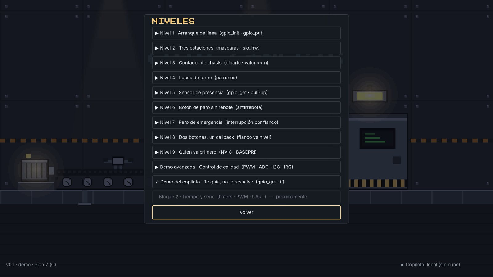
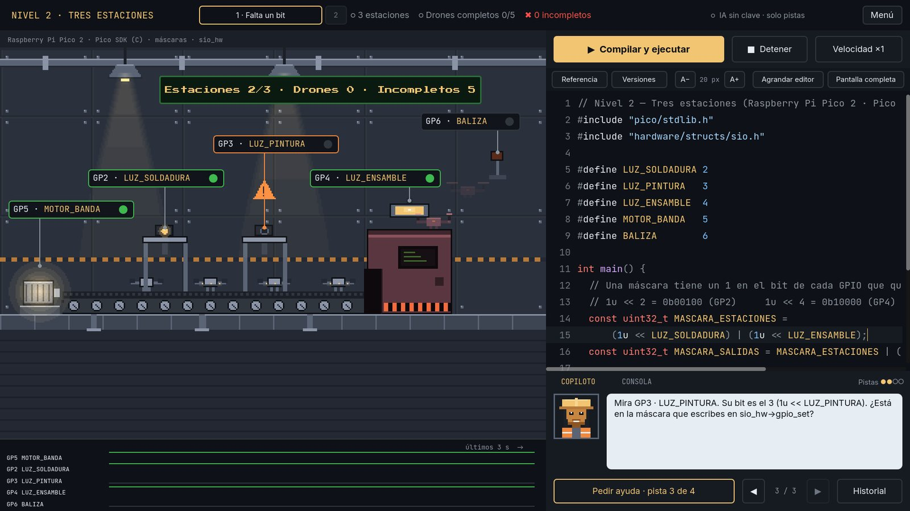
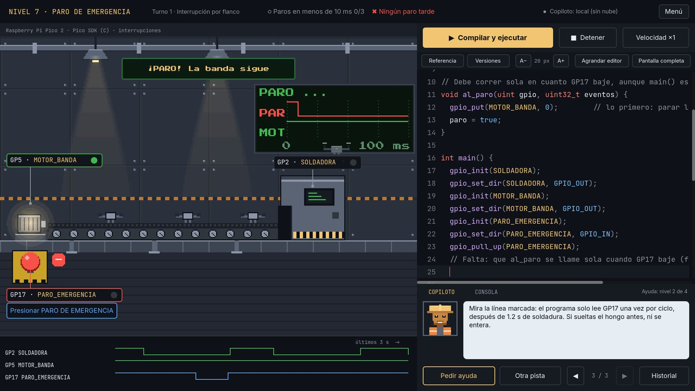
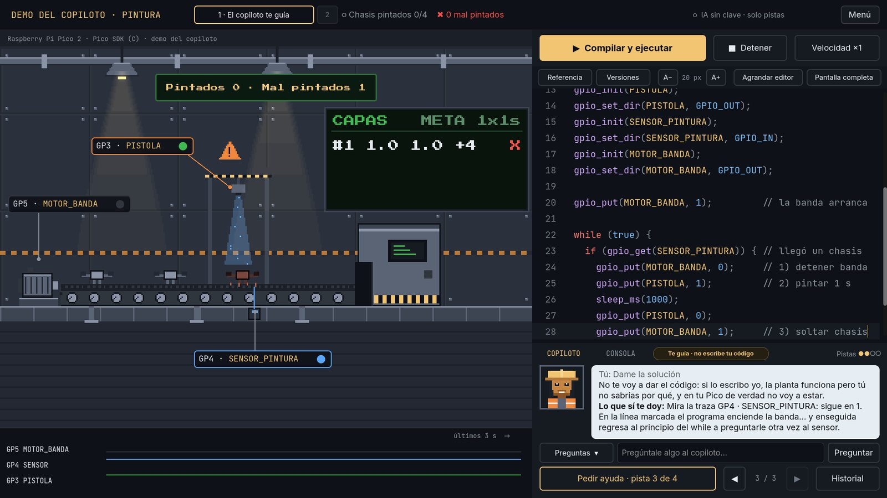
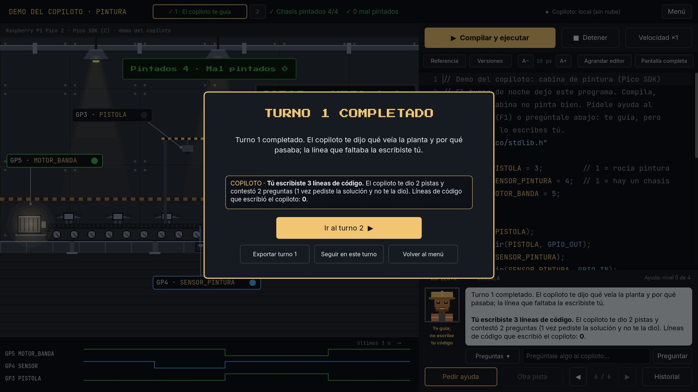

# Semana 8 — Prototipado y diseño para manufactura

**Equipo:** José Carlos y Yael  
**Concepto:** GPIO Génesis — videojuego de una fábrica de drones donde se programa una Raspberry Pi Pico 2 virtual con C/C++ real, con un copiloto de IA  
**Tipo de producto:** 100% digital (sin hardware)  
**Fecha:** 24 de noviembre de 2026

!!! abstract "De qué trata esta semana"
    El curso pide dos cosas: **prototipar para responder una pregunta** (no para "tener algo") y **revisar el diseño para que fabricarlo cueste menos** (DFM). En GPIO Génesis el prototipo es la **Demo v0.1**, un juego jugable para Windows, y "manufacturar" una copia es exportar el `.exe` y distribuirlo.

    Entregables de esta página: plan de prototipado (sección 1), el prototipo construido (sección 2), revisión DFM en cinco pasos (sección 3), pruebas con usuarios (sección 4, **PENDIENTE**), reporte del prototipo (sección 5), circularidad (sección 6), métricas de calidad (sección 7) y respuestas de cierre (sección 8).

!!! warning "Lo que todavía no tenemos"
    **No hemos probado el prototipo con ninguna persona.** Todo lo que viene de usuarios (evidencia, tiempos, si se validó el supuesto) está marcado como **PENDIENTE**. Lo que sí está verificado viene del código del juego y de sus pruebas automáticas.

!!! info "Dólares y pesos"
    Lo que se cobra en dólares (cuota de Steam, dominio, firma de código, Supabase y la API de Claude) se deja en **US$**, porque el tipo de cambio varía. Para sumarlo con lo que está en pesos usamos la aproximación **US$1 ≈ $17.50 MXN** (supuesto del proyecto desde la semana 5, el mismo de los Excel; no es el tipo de cambio del día). Las cifras en pesos que dependen de esa conversión llevan **≈**.

## 0. Cómo adaptamos la semana a un producto digital

| Lo que pide el curso | Qué es en GPIO Génesis |
|---|---|
| Prototipo de forma, función, experiencia o negocio | Renders y bocetos (semana 6), niveles jugables, demo del copiloto y landing con pre-registro |
| BOM con componentes | Servicios por copia (comisión de la tienda e IA) y partes del desarrollo (motor, simulación, niveles, arte, sonido) |
| PCB / PCBA | No aplica (no hay electrónica) |
| Carcasa (número de partes, cierre, material) | Lo que el jugador tiene que instalar: hoy, **un solo `.exe`** |
| Ensamble | Exportar el juego con Godot y publicarlo |
| Proceso y volumen | Exportación de Godot; piloto de 20 jugadores y 400 copias en el año 1 (escenario base) |
| Compatibilidad con JLCPCB | Compatibilidad con Windows y con las reglas de Steam |

## 1. Plan de prototipado (Taller, Parte A)

| Campo | Nuestro plan |
|---|---|
| **Equipo y concepto** | José Carlos y Yael · GPIO Génesis |
| **Supuesto a validar** | Que un estudiante del segmento **entiende por qué falla su código** viendo la fábrica, el osciloscopio y las pistas del copiloto, **sin que nadie le explique**. Si no pasa, el juego es un editor de código con dibujos y la propuesta de valor ("si tu código falla, ves por qué") se cae. |
| **Pregunta precisa** | ¿Puede un estudiante de Mecatrónica o Electrónica que nunca ha usado el Pico SDK **completar el turno 1 del nivel 1 sin ayuda del equipo**? |
| **Tipo de prototipo** | **Experiencia:** la fábrica, el editor y el copiloto juntos, como los usaría un jugador. |
| **Resolución** | **Alta.** La dirección visual ya se probó en baja resolución (renders de la semana 6); ahora la pregunta es si alguien entiende un error real en código real, y eso solo se ve con la demo jugable. |
| **Qué construimos** | Demo v0.1 en Godot 4.7.2 (Windows): niveles 1–9 del bloque 1, demo del copiloto y proyecto del copiloto. Herramientas: Godot, Claude Code, cabeceras del Pico SDK 2.2.0 y gcc para revisar las plantillas. Tiempo: del 5 al 24 de noviembre (horas reales del equipo **POR CONFIRMAR**). |
| **Cómo capturamos evidencia** | Comportamiento: si termina el turno sin ayuda, cuánto tarda, cuántas compilaciones fallan, cuántas pistas pide y si puede decir con sus palabras qué estaba mal. Registro: grabación de pantalla (con permiso) y notas. Si se atora: esperar 30 s y preguntar «¿qué esperabas que hiciera?». |
| **Umbral de éxito** | Si **3 de 3** estudiantes del segmento (y después **4 de 5**, criterio RI-01) terminan el nivel 1 **sin ayuda en 20 minutos o menos** y explican la causa de su error, el supuesto queda validado. |

## 2. El prototipo construido: Demo v0.1

El jugador es el ingeniero de automatización de una planta de drones. Cada nivel es una máquina de la planta conectada a pines de la Pico 2; el jugador escribe el programa en C (o C++) con el Pico SDK, lo compila dentro del juego y ve a la fábrica reaccionar.

| Módulo | Qué hace hoy (verificado en el código) |
|---|---|
| **Menú** | Continuar · Niveles · Portafolio · Opciones · Salir. Abajo dice `v0.1 · demo · Pico 2 (C)`. Guarda el progreso en la PC, sin cuenta. |
| **Niveles** | 9 niveles del bloque 1 del curso: salidas (`gpio_init`, `gpio_put`), máscaras de bits, entradas con pull-up, antirrebote, interrupciones por flanco y prioridades del NVIC. Cada nivel tiene 2 o 3 turnos. Además: demo avanzada (PWM, ADC, I2C), demo del copiloto y proyecto del copiloto. |
| **Nivel 1 · Arranque de línea** | `MOTOR_BANDA` en GP5, `LUZ_ESTACION` en GP2 y `SENSOR_ESTACION` en GP4. Por defecto con el Pico SDK; el nivel 1 también se puede jugar con la API de Arduino (`pinMode`, `digitalWrite`). |
| **Compilador y MCU virtual** | Intérprete propio de C y de lo más usado de C++, con los registros del RP2350 y tiempos por evento (rebote, latencia). 41 programas de C dan la misma salida que gcc y 14 de C++ la misma que g++. |
| **Osciloscopio** | Panel inferior con los **últimos 3 s** de cada pin: 1 = 3.3 V, 0 = 0 V (la Pico 2 trabaja a 3.3 V). |
| **Copiloto** | Detecta el problema, marca la línea y da **hasta 4 pistas locales** (funcionan sin internet). Con la clave de Anthropic del jugador, después de la cuarta le pregunta a Claude. En la demo del copiloto se niega a dar la solución. |
| **Portafolio** | Cada turno se exporta como `main.c` (o `main.cpp`) + `CMakeLists.txt`, listo para el toolchain real de la Pico. |
| **Pruebas automáticas** | 834 pruebas en 5 suites (al 24-nov-2026). Las 28 plantillas y soluciones de los niveles pasan la revisión de gcc (`-fsyntax-only`) con las cabeceras reales del Pico SDK 2.2.0; falta compilarlas para la placa y probarlas en una Pico 2 real. |

??? note "Capturas del prototipo"

    === "Menú de niveles"

        

        Los 9 niveles del bloque 1, las dos demos y el bloque 2 marcado como "próximamente". Abajo: versión y estado del copiloto.

    === "Nivel con pistas"

        

        Nivel 2 · Tres estaciones: falta un bit en la máscara. La estación de pintura no se enciende, el copiloto ya dio 2 de sus 4 pistas y el osciloscopio muestra que GP3 nunca sube.

    === "Falla visible"

        

        Nivel 7 · Paro de emergencia: revisar el botón dentro del ciclo hace que el paro llegue tarde; la planta lo marca como falla.

    === "Copiloto"

        

        Demo del copiloto: al pedir la solución, se niega y da la siguiente pista.

    === "Turno completado"

        

        Al terminar un turno: cuántas líneas escribió el jugador, cuántas pistas pidió y «Líneas de código que escribió el copiloto: 0».

**Cómo llegamos aquí:** cada versión respondió una pregunta técnica antes que la siguiente (detalle en la [página del proyecto final, §10](../proyecto-final.md#s10)).

| # | Fecha | Pregunta | Tipo · resolución | Resultado |
|---|---|---|---|---|
| P1 | 1-oct | ¿Qué estilo deja ver qué pin mueve qué máquina? | Forma · baja | Concepto combinado (semana 6) |
| P3 | 5-nov | ¿Podemos ejecutar el código del jugador dentro del juego? | Función · alta | Intérprete propio en lugar de clang → WebAssembly |
| P4 | 8-nov | ¿Se puede enseñar con la API del curso? | Función · alta | El Pico SDK pasa a ser la opción por defecto |
| P5 | 21–22 nov | ¿El simulador reproduce los tiempos del chip? | Función · alta | Niveles 2–9 con rebote, interrupciones y prioridades |
| P6 | 22–23 nov | ¿El copiloto puede guiar sin escribir el código? | Experiencia · alta | 4 pistas locales y Claude al final |
| P7 | 23–24 nov | ¿Alguien aparta una copia de $249? | Negocio · alta | Landing publicada; **PENDIENTE** medir |

Ninguna de estas preguntas se ha respondido todavía con usuarios: la de esta semana (sección 1) es la primera.

## 3. Revisión DFM (Taller, Parte B)

Revisamos el concepto con Claude siguiendo los cinco pasos del curso. Los montos salen de los Excel de la semana 7: [modelo financiero](../recursos/archivos/semana7/modelo-financiero-gpio-genesis-semana7.xlsx), [costos](../recursos/archivos/semana7/costos-gpio-genesis-semana7.xlsx) y [alcance y niveles](../recursos/archivos/semana7/alcance-niveles-costos-gpio-genesis.xlsx).

### 3.1 Paso 1 — Estimar el costo por copia

En un juego no hay BOM ni carcasa: el desarrollo se reparte entre las copias vendidas y ya trae 15% de indirectos y 30% de contingencia, así que no se vuelven a sumar.

| Concepto (MXN por copia) | 10 copias | 100 copias | 400 copias* |
|---|---|---|---|
| Hardware | $0 | $0 | $0 |
| Desarrollo repartido ($50,596.56 MXN del MVP, horas en pesos) | $5,059.66 | $505.97 | $126.49 |
| Lanzamiento repartido: Steam US$100, dominio US$12, firma US$99 (US$211 ≈ $3,692.50) | ≈ $369.83 | ≈ $36.98 | ≈ $9.23 |
| Nube repartida: Supabase Pro, US$25 al mes = US$300 al año (≈ $5,250) | ≈ $525.00 | ≈ $52.50 | ≈ $13.13 |
| IA del copiloto por jugador: US$0.049 | ≈ $0.86 | ≈ $0.86 | ≈ $0.86 |
| Comisión de Steam (30% de $249 MXN) | $74.70 | $74.70 | $74.70 |
| **Costo unitario total** | **≈ $6,030.04** | **≈ $671.01** | **≈ $224.41** |
| de eso, variable (IA + comisión) | ≈ $75.56 | ≈ $75.56 | ≈ $75.56 |

≈ = incluye costos en dólares convertidos a US$1 ≈ $17.50 MXN. \* La columna de 400 copias (escenario base del año 1) la calculamos aquí con las mismas fórmulas del Excel. Con el precio de $249 deja **≈ $24.59** por copia después de pagar todo, incluidas nuestras horas.

### 3.2 Paso 2 — Reducir el costo de los componentes más caros

Ordenados por lo que pesan en cada copia a 400 copias:

| # | Componente | Por copia | Alternativa DFM | Estado |
|---|---|---|---|---|
| 1 | Comisión de Steam (30%) | $74.70 | Vender las **licencias escolares** directamente con una pasarela (≈ 3.6% + $3 + IVA ≈ **$13.88** por $249, ESTIMADO) y usar Steam solo para la venta al público | Propuesta; es la palanca B2B de la semana 9 |
| 2 | Motor (compilador, MCU virtual, editor) | $51.43 ($20,571) | **Intérprete propio** en GDScript en lugar de la cadena clang → WebAssembly + runtime WAMR que planeamos en la semana 5 (la integración de esa cadena eran unas 60 h estimadas de riesgo) | ✅ Hecho y probado |
| 3 | IA del copiloto | US$1.50 → **US$0.049** (≈ $26.25 → $0.86) | 4 pistas locales por problema (antes 2 locales y 2 en la nube), Claude solo después de la cuarta y Claude Haiku 5.5 en lugar de Haiku 4.5 | ✅ Hecho (tokens **sin medir**) |
| — | Arte de máquinas nuevas | $24.82 ($9,927) | Los niveles 2–9 reutilizan la fábrica base y dibujan sus máquinas con figuras simples desde el código, en lugar de arte nuevo por máquina (el Excel estimaba 6 h por máquina) | ✅ Hecho; falta ver con usuarios si se entiende |

**Antes y después (mismo desarrollo; solo cambia la IA):**

| | Antes (semana 5) | Después (24-nov) |
|---|---|---|
| IA por jugador | US$1.50 ≈ $26.25 (300 consultas, todo en la nube, Haiku 4.5) | US$0.049 ≈ $0.86 (220 consultas, la mitad o menos a la nube, Haiku 5.5) |
| Costo variable por copia | ≈ $100.95 | **≈ $75.56 (−25%)** |
| Costo unitario a 400 copias | ≈ $249.80 (más que el precio) | **≈ $224.41** |

**Opción que dejamos abierta:** usar el plan gratuito de Supabase el primer año (como en el escenario pesimista) ahorraría US$300 al año (≈ $13.13 por copia; ≈ $211.28 de costo unitario a 400 copias), pero el plan gratuito pausa el proyecto tras una semana sin uso; lo decidimos cuando exista el backend.

### 3.3 Paso 3 — Disminuir los costos de "ensamble" (DFA)

| | Plan de la semana 5 | Demo v0.1 |
|---|---|---|
| "Partes" que recibe el jugador | Instalador + compilador clang + runtime WAMR + cuenta en Supabase | **1 archivo:** `GPIO_Genesis.exe` (110 MB, con el paquete del juego adentro) |
| Pasos para empezar a jugar | Descargar, instalar, crear cuenta, iniciar sesión, abrir el nivel | Descargar, abrir, Continuar |
| Lo que hacemos para sacar una versión | — | Correr las 5 suites de pruebas y exportar con el preset "Windows Desktop" (pasos en la [página del proyecto final, §11](../proyecto-final.md#s11)) |
| Tiempo de instalación con una persona | — | **PENDIENTE** (prueba T1 de la semana 9) |

### 3.4 Paso 4 — Reducir el soporte de producción

- **Inventario:** ninguno; una copia nueva cuesta $0 de fabricar.
- **Habilidades especializadas:** GDScript (Godot) y C del Pico SDK. Riesgo: la mayor parte del código se escribió con Claude Code y tenemos que entenderlo para mantenerlo. Lo mitigamos con el registro de desarrollo del juego y las pruebas automáticas.
- **Control de calidad:** 834 pruebas automáticas (intérprete, lenguaje, periféricos, niveles y referencia) que se corren antes de exportar; las plantillas se revisan con gcc contra las cabeceras reales del SDK.

### 3.5 Paso 5 — Efectos en otros factores

| Cambio | Lo que ganamos | Lo que perdemos (trade-off) |
|---|---|---|
| Intérprete propio | Un solo `.exe`, sin instalar compilador; menos tiempo al mercado | No es un compilador completo: no acepta `template`, `new`/`delete`, la biblioteca `std`, `virtual`/herencia ni excepciones |
| Pistas locales + Haiku 5.5 | IA = 0.5% del ingreso neto; el juego funciona sin internet | Las pistas locales solo cubren los errores que imaginamos; la ayuda de Claude depende de que el jugador ponga su clave |
| Pico SDK por defecto | Enseña lo mismo que el curso (RP2350) | Menos transferible para quien usa Arduino (el nivel 1 sigue con las dos opciones) |
| Arte con figuras simples | Más niveles en el mismo tiempo | Puede verse menos atractivo: **por validar con usuarios** |
| Sin backend en la demo | Sin cuenta ni servidor que mantener | No hay progreso en la nube ni cuota de IA con nuestra clave; para vender hace falta (semana 9, regulación) |

### 3.6 Compatibilidad con la "fábrica" (equivalente a JLCPCB)

| Requisito | Estado |
|---|---|
| `.exe` de Windows de 64 bits (preset "Windows Desktop") | ✅ |
| Abre en una PC sin Godot que no sea nuestra | ⚠️ Sin probar |
| Firma de código (sin ella, Windows SmartScreen advierte al abrirlo) | ⚠️ Sin certificado; cotizar |
| Cuota de Steam Direct (US$100 por juego) | ✅ Verificada en la semana 7 |
| Declarar en Steam el contenido generado por IA en vivo | ⚠️ POR VERIFICAR |
| Integración con Steamworks (logros, guardado en la nube de Steam) | ❌ No integrada (no hace falta para la demo) |
| Versión para macOS | ❌ No hay; solo Windows |

### 3.7 Defensa del plan (4 min)

1. **Supuesto más riesgoso:** que el jugador entienda su error sin que se lo expliquemos. Si falla, perdemos la propuesta de valor y la razón para pagar $249 en lugar de ver YouTube gratis.
2. **Prototipo:** Demo v0.1, experiencia de alta resolución; responde si alguien termina el nivel 1 solo.
3. **Evidencia:** 3 de 3 (y luego 4 de 5) terminan el nivel 1 sin ayuda en 20 min o menos y explican la causa de su error.
4. **Cambio DFM más importante:** pistas locales + Haiku 5.5: IA de US$1.50 a US$0.049 por jugador; costo variable de ≈ $100.95 a ≈ $75.56 por copia; a 400 copias, costo unitario de ≈ $249.80 a ≈ $224.41 (con US$1 ≈ $17.50).

## 4. Prueba con usuarios (tarea en casa) — PENDIENTE

!!! danger "PENDIENTE"
    El curso pide probar el prototipo con **al menos 3 usuarios del segmento**. **Todavía no lo hacemos.** Las sesiones se harán con el protocolo de la [semana 9](semana-09.md) (sección 2) y sus resultados se escribirán aquí.

| Usuario | Perfil | ¿Terminó el turno 1 sin ayuda? | Tiempo | Compilaciones con error | Pistas pedidas | ¿Explicó la causa del error? | Cita textual |
|---|---|---|---|---|---|---|---|
| U1 | Segmento | PENDIENTE | | | | | |
| U2 | Segmento | PENDIENTE | | | | | |
| U3 | Segmento | PENDIENTE | | | | | |

## 5. Reporte del prototipo

| Sección | Contenido |
|---|---|
| **Equipo y concepto** | José Carlos y Yael · GPIO Génesis |
| **Tipo y resolución** | Experiencia · alta |
| **Materiales y tiempo** | Godot 4.7.2, Claude Code, cabeceras del Pico SDK 2.2.0, gcc, fuentes con licencia OFL. Del 5 al 24-nov; horas reales **POR CONFIRMAR** (el Excel estimaba 423 h para el MVP). |
| **Pregunta que respondía** | ¿Puede un estudiante que nunca ha usado el Pico SDK completar el turno 1 del nivel 1 sin ayuda? |
| **Evidencia de 3 usuarios** | **PENDIENTE** (sección 4) |
| **¿Se validó el supuesto?** | **PENDIENTE.** Sin pruebas con usuarios no se puede decir Sí, No ni Parcialmente. |
| **Aprendizaje clave (de construirlo, no de usuarios)** | El costo del producto estaba en la IA y en la cadena de compilación: resolverlas con un intérprete propio y pistas locales bajó el costo variable 25% y dejó el juego en un solo archivo. |
| **Cambio al diseño** | Pico SDK por defecto (antes Arduino-ESP32); 4 pistas locales antes de llamar a Claude (antes 2 y 2); un solo `.exe` sin cuenta. |
| **Siguiente hipótesis** | **Negocio:** que alguien deje sus datos para apartar una copia de $249 en la landing (prototipo P7). |

## 6. Circularidad (lente del curso)

| Pregunta del curso | Versión digital | Respuesta |
|---|---|---|
| ¿Se puede reparar? | ¿Se arregla una parte sin romper otra? | Cada nivel es un JSON y su fábrica un script aparte; los errores se corrigen con un parche del `.exe` |
| ¿Módulos reemplazables? | ¿Se cambia una pieza sin rehacer el resto? | El modelo de IA cambia con una variable; el intérprete y la fábrica están separados |
| ¿Materiales identificables? | ¿Se sabe de dónde viene cada pieza y su licencia? | Godot (MIT) y fuentes (OFL). **PENDIENTE:** inventario de licencias |
| ¿Se actualiza sin reemplazar? | ¿Crece sin comprar otro juego? | Los bloques 2 y 3 irían como actualización y las partidas viejas se siguen leyendo |

## 7. Métricas de calidad del software

| Métrica | Objetivo | Cómo se controla | Estado |
|---|---|---|---|
| Compilar y arrancar la planta (RD-01) | P95 ≤ 3 s, 300 líneas, PC mínima | Cronometrar 50 corridas | ⏳ Sin medir |
| Cuadros por segundo (RD-02) | ≥ 30 fps en la PC mínima | Nivel más grande | ⏳ Sin medir |
| Costo del intérprete | Un ciclo que nunca duerme no pasa de ~4 ms por cuadro | Pruebas del MCU virtual | ✅ En pruebas automáticas |
| Ciclos infinitos | El juego no se congela | En modo Arduino, watchdog de 2 s; con el Pico SDK, un `while(true)` es válido, como en el chip | ✅ |
| Tamaño de la descarga | Un solo archivo | `GPIO_Genesis.exe` de 110 MB | ✅ |
| Pista local (RD-03) | ≤ 200 ms | No usa la red | ✅ |
| Respuesta de Claude (RD-03) | ≤ 8 s | Clave real y 5 Mbps | ⏳ Ya responde con una clave real (25-nov); falta medir el tiempo |

## 8. Preguntas de cierre

- **¿Cuál es el supuesto más riesgoso y qué prototipo lo validará?** Que el jugador entienda por qué falla su código sin que se lo expliquemos; lo valida la Demo v0.1 con 3–5 estudiantes del segmento (**PENDIENTE**).
- **¿Qué comportamiento específico se capturará como evidencia?** Si termina el turno 1 del nivel 1 sin ayuda, en cuánto tiempo, cuántas compilaciones fallan, cuántas pistas pide y si explica la causa con sus palabras.
- **¿Cuál es el componente más caro y su alternativa DFM?** Por copia, la comisión de Steam ($74.70): venta directa para grupos escolares. El cambio ya hecho que más pesó fue la IA: de US$1.50 a US$0.049 por jugador (≈ $26.25 a $0.86).
- **¿Cuántas partes tiene la "carcasa" y cómo se redujeron?** Una: el `.exe`. El plan de la semana 5 tenía instalador, compilador, runtime y cuenta.

## Reflexión

Esta semana me di cuenta de que en un proyecto de software es muy fácil confundir avanzar con validar. En unas semanas pasamos de un boceto a un juego con nueve niveles, un copiloto y más de 800 pruebas automáticas, y aun así el supuesto más importante, que un estudiante pueda arrancar la fábrica solo entendiendo por qué falla su código, no lo hemos probado con una sola persona. El prototipo es de alta resolución, pero la evidencia de usuarios todavía está en cero.

También me sirvió traducir el diseño para manufactura a nuestro caso. Al principio pensé que no aplicaba porque no fabricamos nada, pero las mismas preguntas funcionan: cuál es el componente más caro, cuántas "piezas" recibe el usuario y qué tan fácil es reproducir una copia. La decisión que más pesó fue la de la IA: con pistas locales y un modelo más barato, el costo variable bajó de unos $100.95 a unos $75.56 por copia (con el dólar a $17.50), y a 400 copias el costo unitario quedó por debajo del precio. Entregar un solo `.exe`, sin instalador ni cuenta, es nuestra forma de reducir el número de partes.

Lo que haría distinto es probar antes con usuarios. Construir sin evidencia se siente productivo, pero si en las pruebas descubrimos que el copiloto estorba en lugar de ayudar, mucho de lo que hicimos habría que cambiarlo. Por eso lo siguiente no es otro nivel, sino sentar a tres compañeros frente al nivel 1 y observar qué hacen sin ayudarles.
